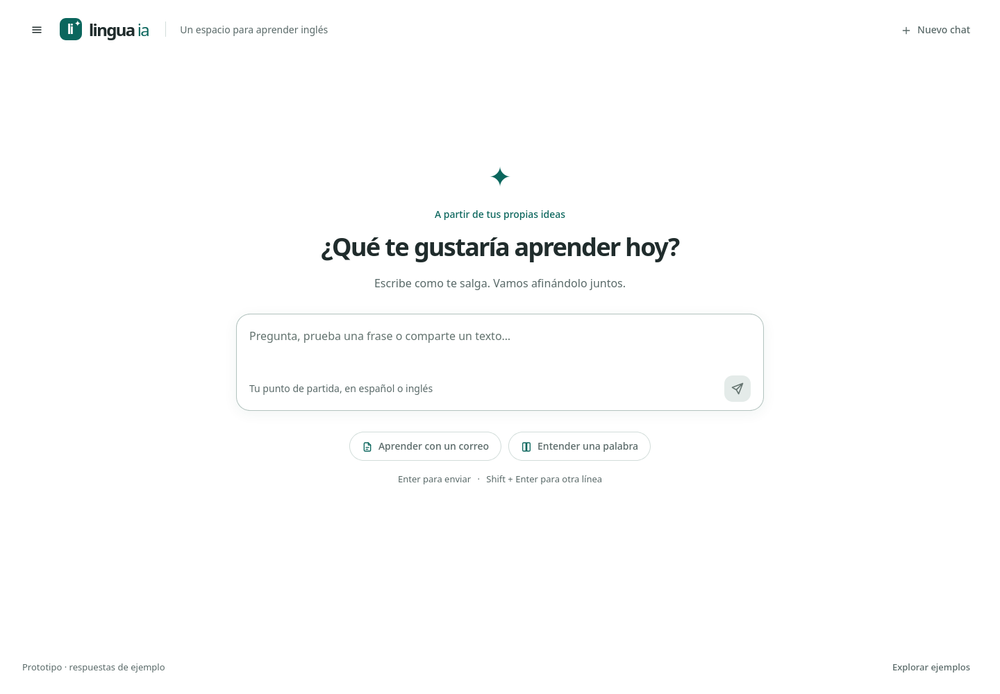
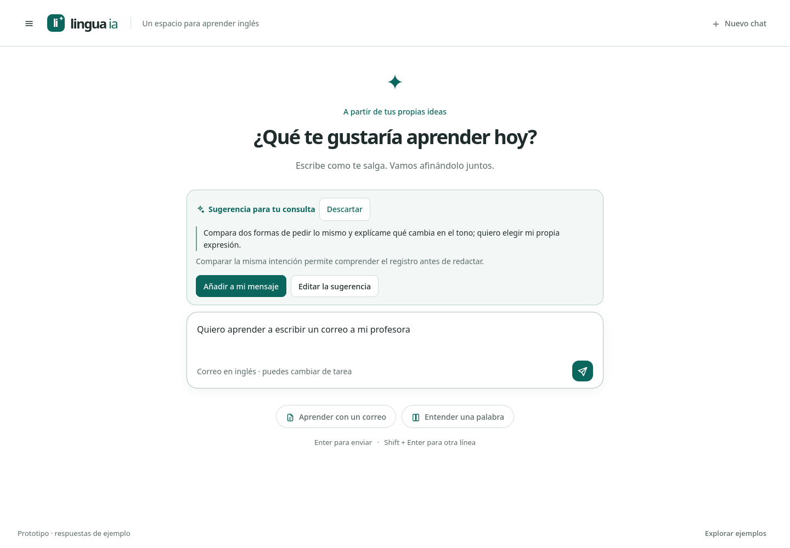
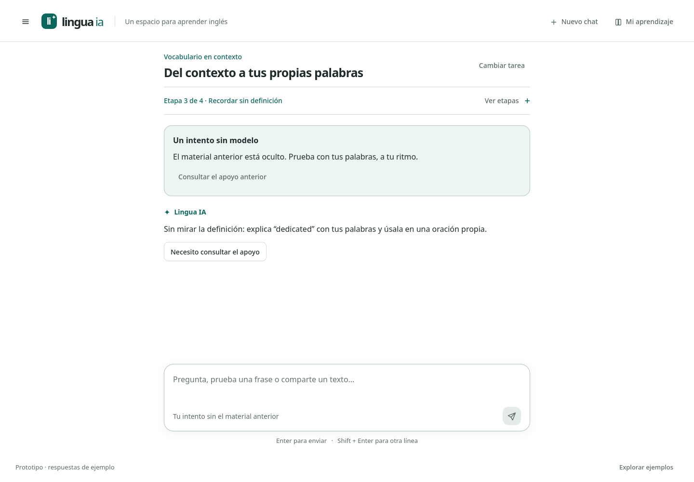
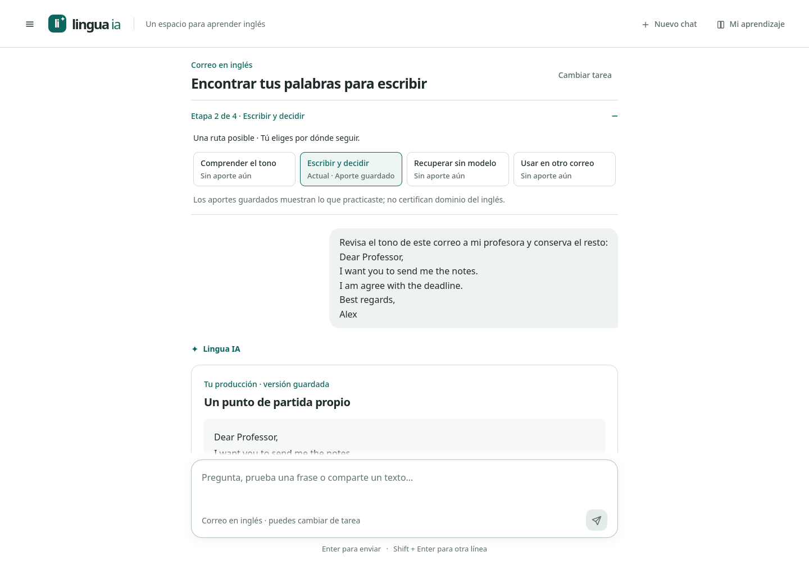
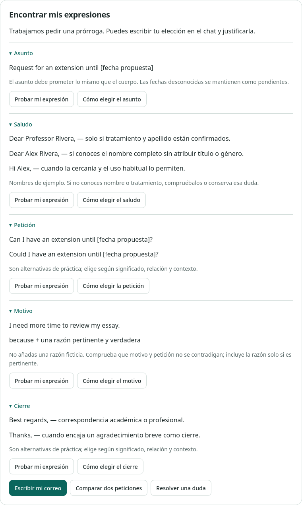
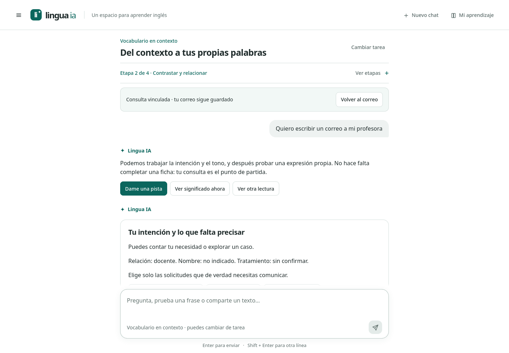
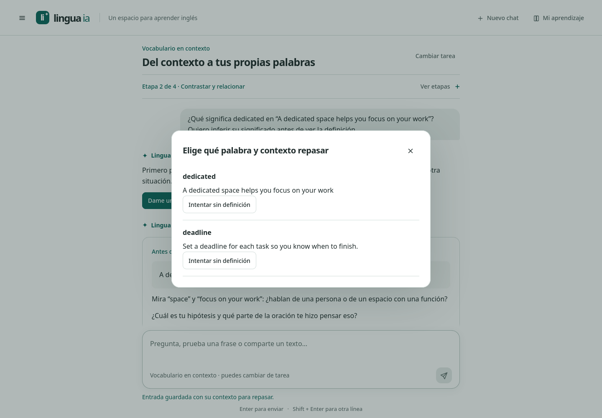
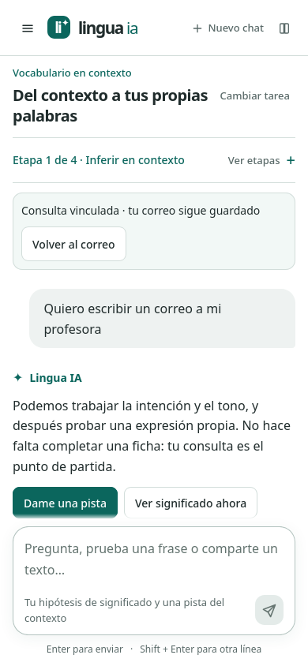

# Guía de principios IHC · interfaz conversacional

Revisión técnica: 25/11/2026 · Correo y vocabulario · Prototipo local

Referencia de tareas vigente: HTA_correo_vocabulario_v8.pdf (C0 y V0). La guía conserva los 71 principios y sus nombres de la matriz original. La columna de origen mantiene su clasificación binaria (44 cumplen y 27 no cumplen). El estado actual se revisa contra el prototipo conversacional: aplicado significa una decisión de diseño inspeccionable, no aprobación docente ni validación experimental. Parcial, pendiente, excluido y no aplica explican límites distintos; ninguno se cuenta como cumplimiento total.

La cobertura por nodo está en docs/HTA_V8_COBERTURA.md. Las vías de recursos son ejemplos preparados o aportes externos no verificados; no servicios conectados.

Los originales anteriores al rediseño se conservan en docs/originales/principios-anterior/. El PDF y DOCX de la matriz de entrada permanecen intactos. Las capturas actuales se generan con tools/generate_screenshots.py; los recorridos completos están en guia.md y la correspondencia con el HTA en docs/REVISION_HTA_Y_TRAZABILIDAD.md.

## Resultado de la revisión

| Estado actual | Cantidad |
|---|---:|
| Aplicado | 49 |
| Excluido | 2 |
| Pendiente | 3 |
| Parcial | 6 |
| No aplica | 11 |

Se mantienen los 44 principios aplicados de la matriz original, con evidencia nueva. Algunas reglas antes no cumplidas se aplican ahora. Las pruebas funcionales no acreditan comprensión, accesibilidad completa ni reducción de prompts.

## Recorrido para revisar

1. Abre index.html y escribe una intención de correo: revisa la sugerencia opcional, edítala o descártala.
2. En Explorar ejemplos prepara el correo de revisión: compara Gramática/Tono, aplica y deshaz; recupera el original desde Mi aprendizaje.
3. Prepara el ejemplo léxico: escribe una hipótesis, contrástala, guarda/retira una palabra e intenta recuperarla sin definición.
4. Abre Mi aprendizaje y Conversaciones: comprueba notas, ayuda consultada y versiones. Retoma después desde el mismo navegador.
5. Consulta guia.md para los mensajes exactos y los límites de cada escenario.

## Catálogo de los 71 principios

### C1 · La percepción es sesgada

#### C1.1 · Evitar la ambigüedad
- Matriz original: **Cumple**. Estado actual: **Aplicado**.
- Evidencia / razón: Acciones con resultado explícito: Añadir a mi mensaje, Conservar mi frase y Recuperar una versión.
- Localización real: `[data-action="use-prompt"]`.
- Captura del escenario: [02_sugerencia.png](docs/screenshots/actual/02_sugerencia.png).

#### C1.2 · Mantener consistencia de ubicación y apariencia
- Matriz original: **Cumple**. Estado actual: **Aplicado**.
- Evidencia / razón: La cabecera permanece visible durante el desplazamiento; el compositor y las acciones conservan estilo y función entre correo y vocabulario.
- Localización real: `.app-header`.
- Captura del escenario: [01_inicio.png](docs/screenshots/actual/01_inicio.png).

#### C1.3 · Diseñar para las metas del usuario
- Matriz original: **Cumple**. Estado actual: **Aplicado**.
- Evidencia / razón: Se comienza con una intención libre y la ayuda se deriva de destinatario, contexto y propósito de aprendizaje.
- Localización real: `#prompt-assist`.
- Captura del escenario: [02_sugerencia.png](docs/screenshots/actual/02_sugerencia.png).

### C2 · La visión está optimizada para ver estructura

#### C2.1 · Proximidad: agrupar lo relacionado
- Matriz original: **Cumple**. Estado actual: **Aplicado**.
- Evidencia / razón: Cada revisión agrupa fragmento, propuesta, motivo y decisión; la consulta léxica conserva su oración.
- Localización real: `.correction-card`.
- Captura del escenario: [04_revision.png](docs/screenshots/actual/04_revision.png).

#### C2.2 · Similitud: mismo aspecto para la misma función
- Matriz original: **Cumple**. Estado actual: **Aplicado**.
- Evidencia / razón: Botones, tarjetas y estados equivalentes reutilizan componentes y estilos.
- Localización real: `.card`.
- Captura del escenario: [04_revision.png](docs/screenshots/actual/04_revision.png).

#### C2.3 · Continuidad: alinear y no interrumpir
- Matriz original: **Cumple**. Estado actual: **Aplicado**.
- Evidencia / razón: Lectura, comparación y acciones comparten ejes; la ruta mantiene el orden de las sugerencias.
- Localización real: `#stagebar`.
- Captura del escenario: [03_comparar.png](docs/screenshots/actual/03_comparar.png).

#### C2.4 · Cierre: formas simples y reconocibles
- Matriz original: **Cumple**. Estado actual: **Aplicado**.
- Evidencia / razón: Iconos lineales simples acompañan etiquetas; el envío tiene un nombre accesible.
- Localización real: `#send-btn`.
- Captura del escenario: [01_inicio.png](docs/screenshots/actual/01_inicio.png).

#### C2.5 · Simetría: reducir complejidad
- Matriz original: **Cumple**. Estado actual: **Aplicado**.
- Evidencia / razón: Columna central y comparaciones de igual peso; en móvil las alternativas se apilan sin perder su asociación.
- Localización real: `.comparison`.
- Captura del escenario: [03_comparar.png](docs/screenshots/actual/03_comparar.png).

#### C2.6 · Figura/fondo: separar planos
- Matriz original: **Cumple**. Estado actual: **Aplicado**.
- Evidencia / razón: Conversaciones se abre en un panel lateral izquierdo de alto completo; los paneles solicitados usan dialog con fondo separado, foco modal y cierre.
- Localización real: `#workspace-dialog`.
- Captura del escenario: [07_aprendizaje.png](docs/screenshots/actual/07_aprendizaje.png).

#### C2.7 · Destino común: lo que se mueve junto está relacionado
- Matriz original: **No cumple**. Estado actual: **Excluido**.
- Evidencia / razón: No hay contenido en movimiento que deba agruparse. Se evita añadir animación sin una función de aprendizaje.
- Localización real: `body`.

#### C2.8 · Revisar las agrupaciones combinadas
- Matriz original: **No cumple**. Estado actual: **Pendiente**.
- Evidencia / razón: La agrupación se ha inspeccionado en capturas; faltan revisión por dos personas y pruebas de percepción con usuarios.
- Localización real: `.comparison`.

### C3 · Buscamos y usamos estructura visual

#### C3.1 · Presentar información tersa y estructurada
- Matriz original: **Cumple**. Estado actual: **Aplicado**.
- Evidencia / razón: Explicaciones breves; detalles de reglas y ejemplos se revelan bajo demanda.
- Localización real: `.rule`.
- Captura del escenario: [05_vocabulario.png](docs/screenshots/actual/05_vocabulario.png).

#### C3.2 · Establecer una jerarquía visual
- Matriz original: **Cumple**. Estado actual: **Aplicado**.
- Evidencia / razón: La intención precede a los mensajes; las propuestas y acciones se distinguen por tamaño, espacio y contraste.
- Localización real: `.conversation-heading`.
- Captura del escenario: [03_comparar.png](docs/screenshots/actual/03_comparar.png).

#### C3.3 · Usar encabezados semánticos
- Matriz original: **No cumple**. Estado actual: **Parcial**.
- Evidencia / razón: Hay encabezados semánticos h1/h2/h3, labels, dialog y log. Falta comprobar toda la interacción con un lector de pantalla real.
- Localización real: `#chat-title`.

#### C3.4 · Agrupar contenido similar
- Matriz original: **Cumple**. Estado actual: **Aplicado**.
- Evidencia / razón: El panel lateral izquierdo agrupa correo, vocabulario y chats por explorar por tarea; las palabras permanecen junto al contexto.
- Localización real: `.history-group`.
- Captura del escenario: [08_historial.png](docs/screenshots/actual/08_historial.png).

#### C3.5 · Agrupar los datos en bloques (chunking)
- Matriz original: **Cumple**. Estado actual: **Aplicado**.
- Evidencia / razón: Las métricas separan aportes y palabras. Las revisiones se dividen en antes, propuesta, motivo y decisión.
- Localización real: `.metrics`.
- Captura del escenario: [07_aprendizaje.png](docs/screenshots/actual/07_aprendizaje.png).

#### C3.6 · Usar campos segmentados cuando reduzcan errores
- Matriz original: **No cumple**. Estado actual: **No aplica**.
- Evidencia / razón: No se piden identificadores, teléfonos ni fechas compuestas. Fragmentar el mensaje libre volvería a introducir el formulario que se quiere evitar.
- Localización real: `#chat-input`.

#### C3.7 · Usar controles específicos para cada tipo de dato
- Matriz original: **Cumple**. Estado actual: **Aplicado**.
- Evidencia / razón: Texto libre para producir y razonar; botones para aceptar, conservar, guardar o mostrar apoyos. No se convierte la tarea en una ficha.
- Localización real: `#chat-input`.
- Captura del escenario: [04_revision.png](docs/screenshots/actual/04_revision.png).

#### C3.8 · Mantener las etiquetas junto a sus valores
- Matriz original: **Cumple**. Estado actual: **Aplicado**.
- Evidencia / razón: Tu frase, Propuesta y la categoría se encuentran junto a sus valores, también en la comparación léxica.
- Localización real: `.diff-line`.
- Captura del escenario: [04_revision.png](docs/screenshots/actual/04_revision.png).

#### C3.9 · Evitar el ruido en los resultados de búsqueda
- Matriz original: **No cumple**. Estado actual: **No aplica**.
- Evidencia / razón: No existe una página de resultados de búsqueda. Las fichas preparadas no se presentan como resultados de una búsqueda.
- Localización real: `.word-detail`.

### C4 · La visión del color es limitada

#### C4.1 · Usar colores distintivos
- Matriz original: **Cumple**. Estado actual: **Aplicado**.
- Evidencia / razón: Gramática usa azul y Tono usa ocre, con nombres visibles. La decisión no depende del color.
- Localización real: `.badge.grammar`.
- Captura del escenario: [04_revision.png](docs/screenshots/actual/04_revision.png).

#### C4.2 · No yuxtaponer colores opuestos fuertes
- Matriz original: **No cumple**. Estado actual: **Aplicado**.
- Evidencia / razón: La revisión utiliza azul y ocre sobre fondos suaves, separados por espacio; no hay rojo y verde saturados yuxtapuestos.
- Localización real: `.badge`.

#### C4.3 · Diferenciar por saturación y brillo, no solo por tono
- Matriz original: **Cumple**. Estado actual: **Aplicado**.
- Evidencia / razón: Texto oscuro sobre fondos suaves; el foco y el borde de la propuesta añaden diferencias de luminosidad.
- Localización real: `.diff-line.proposal`.
- Captura del escenario: [04_revision.png](docs/screenshots/actual/04_revision.png).

#### C4.4 · Evitar pares problemáticos para daltonismo
- Matriz original: **Cumple**. Estado actual: **Aplicado**.
- Evidencia / razón: No se depende del par rojo/verde; categorías y estados se repiten en texto. No equivale a una validación con personas con daltonismo.
- Localización real: `.badge.tone`.
- Captura del escenario: [04_revision.png](docs/screenshots/actual/04_revision.png).

#### C4.5 · No usar color como único canal
- Matriz original: **Cumple**. Estado actual: **Aplicado**.
- Evidencia / razón: Categoría, antes/después, decisión y estado se expresan mediante rótulos, no solo color.
- Localización real: `.badge`.
- Captura del escenario: [04_revision.png](docs/screenshots/actual/04_revision.png).

#### C4.6 · Asegurar contraste de los elementos no textuales
- Matriz original: **No cumple**. Estado actual: **Parcial**.
- Evidencia / razón: Foco visible de 3 px e iconos oscuros. No se declara una medición exhaustiva de contraste para todos los bordes y estados.
- Localización real: `#send-btn`.

#### C4.7 · Considerar las condiciones externas de visualización
- Matriz original: **No cumple**. Estado actual: **Pendiente**.
- Evidencia / razón: Falta comprobar pantallas, brillo, reflejos y dispositivos reales del público objetivo. Las capturas de un navegador no sustituyen esa prueba.
- Localización real: `body`.

### C5 · La visión periférica es pobre

#### C5.1 · Colocar la información importante donde mira el usuario
- Matriz original: **Cumple**. Estado actual: **Aplicado**.
- Evidencia / razón: La sugerencia de consulta aparece junto al compositor y la explicación junto al fragmento que se revisa.
- Localización real: `#prompt-assist`.
- Captura del escenario: [02_sugerencia.png](docs/screenshots/actual/02_sugerencia.png).

#### C5.2 · Mostrar los errores junto a su causa
- Matriz original: **No cumple**. Estado actual: **No aplica**.
- Evidencia / razón: No hay errores de validación de formularios. El envío vacío se deshabilita y las limitaciones de revisión aparecen junto al texto.
- Localización real: `#composer-notice`.

#### C5.3 · Marcar el error con símbolo y reservar el rojo
- Matriz original: **No cumple**. Estado actual: **Aplicado**.
- Evidencia / razón: La propuesta gramatical muestra un símbolo y el rótulo Gramática; la elección de tono usa su propia etiqueta. No se emplea rojo para señalar una preferencia estilística.
- Localización real: `.badge.grammar`.

#### C5.4 · Usar señales que “pop” en la periferia
- Matriz original: **No cumple**. Estado actual: **Excluido**.
- Evidencia / razón: No existen avisos periféricos urgentes. Las sugerencias se sitúan junto a la escritura y pueden ignorarse.
- Localización real: `#prompt-assist`.

#### C5.5 · Reservar los pop-ups para lo crítico
- Matriz original: **No cumple**. Estado actual: **Aplicado**.
- Evidencia / razón: No se abren ventanas automáticas. Los paneles se solicitan expresamente; reglas y explicaciones se despliegan en el mismo contexto.
- Localización real: `.rule`.

#### C5.6 · Usar sonido con moderación
- Matriz original: **No cumple**. Estado actual: **No aplica**.
- Evidencia / razón: La práctica seleccionada es textual y no necesita sonidos de alerta ni audio.
- Localización real: `#chat-messages`.

#### C5.7 · Mantener el movimiento o parpadeo breve
- Matriz original: **No cumple**. Estado actual: **No aplica**.
- Evidencia / razón: No hay parpadeos ni animaciones de aviso; no existe una duración de movimiento que limitar.
- Localización real: `body`.

#### C5.8 · Evitar la habituación a las alertas
- Matriz original: **Cumple**. Estado actual: **Aplicado**.
- Evidencia / razón: Sin sonidos, ventanas automáticas ni avisos repetitivos; la confirmación permanece junto al mensaje.
- Localización real: `#composer-notice`.
- Captura del escenario: [04_revision.png](docs/screenshots/actual/04_revision.png).

#### C5.9 · No mover los ítems de menús, listas o paletas
- Matriz original: **Cumple**. Estado actual: **Aplicado**.
- Evidencia / razón: Las categorías del historial mantienen el orden Correo, Vocabulario y Por explorar; las conversaciones conservan su orden de creación.
- Localización real: `.history-group`.
- Captura del escenario: [08_historial.png](docs/screenshots/actual/08_historial.png).

#### C5.10 · Diseñar iconos distintivos para la periferia
- Matriz original: **Cumple**. Estado actual: **Aplicado**.
- Evidencia / razón: Iconos de documento, libro, nuevo chat y conversaciones mantienen siluetas diferentes, acompañadas de etiquetas o nombres accesibles.
- Localización real: `.header-actions`.
- Captura del escenario: [01_inicio.png](docs/screenshots/actual/01_inicio.png).

### C6 · Leer no es natural

#### C6.1 · Usar un tamaño de texto legible
- Matriz original: **No cumple**. Estado actual: **Aplicado**.
- Evidencia / razón: Cuerpo a 16 px y etiquetas regulares a 14 px. Metadatos breves pueden ser menores; se verificó ausencia de desbordamiento a 320, 390 y 1440 px. La comodidad lectora requiere usuarios.
- Localización real: `body`.

#### C6.2 · Usar lenguaje llano y vocabulario familiar
- Matriz original: **Cumple**. Estado actual: **Aplicado**.
- Evidencia / razón: Las instrucciones usan español cotidiano y el inglés se reserva al material de aprendizaje.
- Localización real: `.message-content`.
- Captura del escenario: [03_comparar.png](docs/screenshots/actual/03_comparar.png).

#### C6.3 · Usar tipografías familiares y legibles
- Matriz original: **Cumple**. Estado actual: **Aplicado**.
- Evidencia / razón: Se usa una tipografía sans serif del sistema sin depender de descargas ni fuentes decorativas para la lectura.
- Localización real: `body`.
- Captura del escenario: [01_inicio.png](docs/screenshots/actual/01_inicio.png).

#### C6.4 · No usar TODO EN MAYÚSCULAS en el cuerpo
- Matriz original: **Cumple**. Estado actual: **Aplicado**.
- Evidencia / razón: Títulos e instrucciones utilizan mayúsculas y minúsculas; no hay párrafos en mayúsculas sostenidas.
- Localización real: `#welcome-title`.
- Captura del escenario: [01_inicio.png](docs/screenshots/actual/01_inicio.png).

#### C6.5 · Evitar fondos ruidosos detrás del texto
- Matriz original: **Cumple**. Estado actual: **Aplicado**.
- Evidencia / razón: Los textos se leen sobre fondos sólidos; no hay imágenes ni patrones detrás de las explicaciones.
- Localización real: `.reading-card`.
- Captura del escenario: [05_vocabulario.png](docs/screenshots/actual/05_vocabulario.png).

#### C6.6 · Asegurar contraste de texto suficiente
- Matriz original: **No cumple**. Estado actual: **Parcial**.
- Evidencia / razón: Se usa texto oscuro sobre fondos claros; falta una auditoría completa de todos los pares, estados, zoom y ajustes del usuario. No se afirma conformidad WCAG global.
- Localización real: `body`.

#### C6.7 · No centrar párrafos de texto
- Matriz original: **Cumple**. Estado actual: **Aplicado**.
- Evidencia / razón: Mensajes, correos, lectura y explicaciones se alinean a la izquierda; solo se centran título inicial y metadatos breves.
- Localización real: `.message-content`.
- Captura del escenario: [05_vocabulario.png](docs/screenshots/actual/05_vocabulario.png).

#### C6.8 · Mantener una alineación consistente
- Matriz original: **Cumple**. Estado actual: **Aplicado**.
- Evidencia / razón: Las tarjetas equivalentes comparten márgenes y las comparaciones mantienen alineación.
- Localización real: `.comparison`.
- Captura del escenario: [03_comparar.png](docs/screenshots/actual/03_comparar.png).

#### C6.9 · Formatear el texto para escaneo
- Matriz original: **Cumple**. Estado actual: **Aplicado**.
- Evidencia / razón: Títulos reales, rótulos, separación y detalles facilitan recorrer original, alternativa y razón.
- Localización real: `.correction-card`.
- Captura del escenario: [04_revision.png](docs/screenshots/actual/04_revision.png).

#### C6.10 · Minimizar la prosa
- Matriz original: **Cumple**. Estado actual: **Aplicado**.
- Evidencia / razón: El inicio contiene una invitación, un compositor y dos ideas; la ruta y las explicaciones extensas se despliegan a petición.
- Localización real: `#welcome`.
- Captura del escenario: [01_inicio.png](docs/screenshots/actual/01_inicio.png).

#### C6.11 · Eliminar la repetición que entierra información
- Matriz original: **Cumple**. Estado actual: **Aplicado**.
- Evidencia / razón: No hay panel lateral permanente que repita texto o progreso; la información auxiliar se consulta cuando se necesita.
- Localización real: `#learning-plan`.
- Captura del escenario: [01_inicio.png](docs/screenshots/actual/01_inicio.png).

#### C6.12 · Probar la lectura con usuarios reales
- Matriz original: **No cumple**. Estado actual: **Pendiente**.
- Evidencia / razón: No se ha realizado una prueba de comprensión y lectura con estudiantes del público objetivo. Las pruebas automáticas no cubren este principio.
- Localización real: `.reading-card`.

### C7 · La atención es limitada; la memoria es imperfecta

#### C7.1 · No exigir recordar el estado o las acciones previas
- Matriz original: **Cumple**. Estado actual: **Aplicado**.
- Evidencia / razón: Las consultas conservan fragmento, versión, actividad y mensaje pendiente; el retorno sigue disponible al desplazar y tras recargar. Las prácticas v1 se migran al estado v2.
- Localización real: `[data-action="hta-return"]`.
- Captura del escenario: [16_consulta_retorno.png](docs/screenshots/actual/16_consulta_retorno.png).

#### C7.2 · Mantener la salida de voz breve y segmentada
- Matriz original: **No cumple**. Estado actual: **No aplica**.
- Evidencia / razón: No hay salida de voz; el contenido se comunica por texto al ritmo del estudiante.
- Localización real: `#chat-messages`.

#### C7.3 · Limitar las listas de opciones en VUI
- Matriz original: **No cumple**. Estado actual: **No aplica**.
- Evidencia / razón: No hay interfaz de voz ni listas de opciones habladas.
- Localización real: `#chat-input`.

#### C7.4 · Apoyar la VUI con salida visual cuando haya pantalla
- Matriz original: **No cumple**. Estado actual: **No aplica**.
- Evidencia / razón: No existe una interfaz de voz que deba acompañarse de salida visual.
- Localización real: `#chat-messages`.

#### C7.5 · Evitar modos o hacer visible el modo actual
- Matriz original: **Cumple**. Estado actual: **Aplicado**.
- Evidencia / razón: La tarea y la etapa actual permanecen en una franja fija bajo el menú; Cambiar tarea permite corregir la ubicación. No hay cambios silenciosos entre actividades al escribir.
- Localización real: `#task-label`.
- Captura del escenario: [03_comparar.png](docs/screenshots/actual/03_comparar.png).

#### C7.6 · Mostrar los términos de búsqueda en los resultados
- Matriz original: **No cumple**. Estado actual: **No aplica**.
- Evidencia / razón: No existe búsqueda externa ni una página de resultados. El mensaje original sí se conserva en el chat.
- Localización real: `#chat-messages`.

#### C7.7 · Mantener una sola llamada a la acción dominante
- Matriz original: **Cumple**. Estado actual: **Aplicado**.
- Evidencia / razón: Enviar es la acción principal del compositor; cada propuesta distingue su opción de uso de las alternativas secundarias.
- Localización real: `#send-btn`.
- Captura del escenario: [04_revision.png](docs/screenshots/actual/04_revision.png).

#### C7.8 · Preferir una navegación amplia y poco profunda
- Matriz original: **Cumple**. Estado actual: **Aplicado**.
- Evidencia / razón: Dos ideas de inicio y acceso directo al historial, ruta y notas; no hay un asistente secuencial obligatorio.
- Localización real: `#starter-actions`.
- Captura del escenario: [01_inicio.png](docs/screenshots/actual/01_inicio.png).

#### C7.9 · Mostrar la ruta de navegación (breadcrumbs) en jerarquías profundas
- Matriz original: **No cumple**. Estado actual: **No aplica**.
- Evidencia / razón: La navegación es poco profunda: chat y panel solicitado. El encabezado identifica la actividad sin necesitar una ruta de carpetas.
- Localización real: `#task-label`.

#### C7.10 · No exigir el recuerdo de datos o procedimientos
- Matriz original: **Cumple**. Estado actual: **Aplicado**.
- Evidencia / razón: Reglas, ejemplos y versiones siguen accesibles. La recuperación sin apoyo es una práctica explícita y voluntaria, con opción de consultar.
- Localización real: `#recall-banner`.
- Captura del escenario: [06_recuperar.png](docs/screenshots/actual/06_recuperar.png).

#### C7.11 · Permitir autenticación sin datos arbitrarios
- Matriz original: **No cumple**. Estado actual: **No aplica**.
- Evidencia / razón: El prototipo no administra cuentas, contraseñas ni recuperación de autenticación.
- Localización real: `.app-header`.

### C8 · Los límites de la atención moldean pensamiento y acción

#### C8.1 · Hacer que el software pase a segundo plano
- Matriz original: **Cumple**. Estado actual: **Aplicado**.
- Evidencia / razón: La intención, la lectura y la producción propia ocupan el centro. La ruta permanece plegada inicialmente.
- Localización real: `#main`.
- Captura del escenario: [01_inicio.png](docs/screenshots/actual/01_inicio.png).

#### C8.2 · Hacer altamente salientes los cambios importantes
- Matriz original: **Cumple**. Estado actual: **Aplicado**.
- Evidencia / razón: Cambios aceptados o conservados muestran estado en su tarjeta y confirmación junto al compositor; las versiones anteriores no se borran.
- Localización real: `#composer-notice`.
- Captura del escenario: [04_revision.png](docs/screenshots/actual/04_revision.png).

#### C8.3 · Mostrar lo hecho y lo pendiente
- Matriz original: **Cumple**. Estado actual: **Aplicado**.
- Evidencia / razón: El indicador siempre visible muestra Etapa actual de cuatro. La ruta distingue Actual, Aporte guardado y Sin aporte aún. Cambiar de actividad actualiza la etapa; abrirla no registra una producción ni certifica dominio.
- Localización real: `#stagebar`.
- Captura del escenario: [11_etapas.png](docs/screenshots/actual/11_etapas.png).

#### C8.4 · Permitir marcar, mover o colorear elementos
- Matriz original: **No cumple**. Estado actual: **Parcial**.
- Evidencia / razón: Se pueden guardar y retirar palabras del repaso. No se añaden colores personales ni reordenamiento de elementos; no es necesario para demostrar las dos tareas.
- Localización real: `[data-action="save-word"]`.

#### C8.5 · Proporcionar un rastro de información claro (information scent)
- Matriz original: **Cumple**. Estado actual: **Aplicado**.
- Evidencia / razón: Las opciones nombran el resultado: Comparar dos peticiones, Ver significado ahora y Probar sin definición.
- Localización real: `[data-action="definition"]`.
- Captura del escenario: [05_vocabulario.png](docs/screenshots/actual/05_vocabulario.png).

#### C8.6 · Usar verbos específicos en las confirmaciones
- Matriz original: **Cumple**. Estado actual: **Aplicado**.
- Evidencia / razón: Confirmaciones y decisiones usan verbos concretos, incluida la acción de deshacer o usar una versión.
- Localización real: `[data-action="undo-correction"]`.
- Captura del escenario: [04_revision.png](docs/screenshots/actual/04_revision.png).

#### C8.7 · Diseñar caminos y conceptos basados en la tarea
- Matriz original: **Cumple**. Estado actual: **Aplicado**.
- Evidencia / razón: Los tres casos de correo y los apoyos léxicos ejecutan las alternativas y retornos de la v8; la matriz vincula 29 planes y 80 hojas sin imponer un formulario.
- Localización real: `[data-action="hta-parts"]`.
- Captura del escenario: [15_expresiones.png](docs/screenshots/actual/15_expresiones.png).

#### C8.8 · Dar feedback, progreso y opción de volver atrás
- Matriz original: **No cumple**. Estado actual: **Parcial**.
- Evidencia / razón: Hay confirmaciones, notas persistentes y reversión de decisiones y versiones. No existe deshacer global de mensajes o todas las acciones; no se declara cumplimiento total.
- Localización real: `[data-action="undo-correction"]`.

#### C8.9 · Preferir caminos familiares y mostrar atajos
- Matriz original: **No cumple**. Estado actual: **Aplicado**.
- Evidencia / razón: Se usan Enter para enviar, Shift+Enter para otra línea y Escape nativo para cerrar dialog. El compositor muestra los atajos familiares.
- Localización real: `.composer-footnote`.

#### C8.10 · Gestionar los pasos de cierre
- Matriz original: **Cumple**. Estado actual: **Aplicado**.
- Evidencia / razón: El cierre es una acción explícita en Mi aprendizaje: resume actividad, permite descargar notas y dejar una duda para retomar. No declara una tarea dominada por navegar hasta el final.
- Localización real: `[data-action="finish"]`.
- Captura del escenario: [07_aprendizaje.png](docs/screenshots/actual/07_aprendizaje.png).

#### C8.11 · Revertir automáticamente los modos especiales
- Matriz original: **No cumple**. Estado actual: **Parcial**.
- Evidencia / razón: La práctica sin modelo se indica de forma explícita y permite salir con Consultar el apoyo anterior. No expira por tiempo: una salida automática interrumpiría la recuperación al ritmo del estudiante.
- Localización real: `#recall-banner`.

## Evidencias visuales actuales

## Límites de la evaluación

Las fichas, escenarios y reglas son material de demostración, no consultas a una IA o diccionario en vivo. Las fechas de aportes son registros locales; la adquisición de conocimiento debe evaluarse mediante explicaciones, transferencia y recuperación posterior con usuarios. No se declara una mejora medida de consultas, tiempo, tokens ni aprendizaje.
