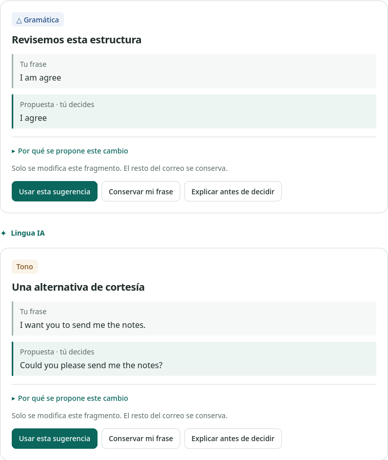
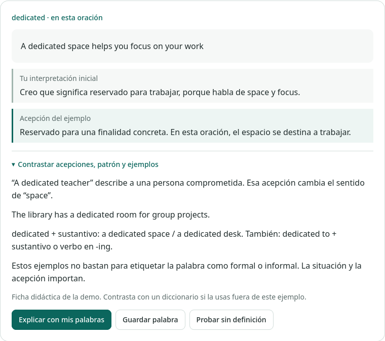
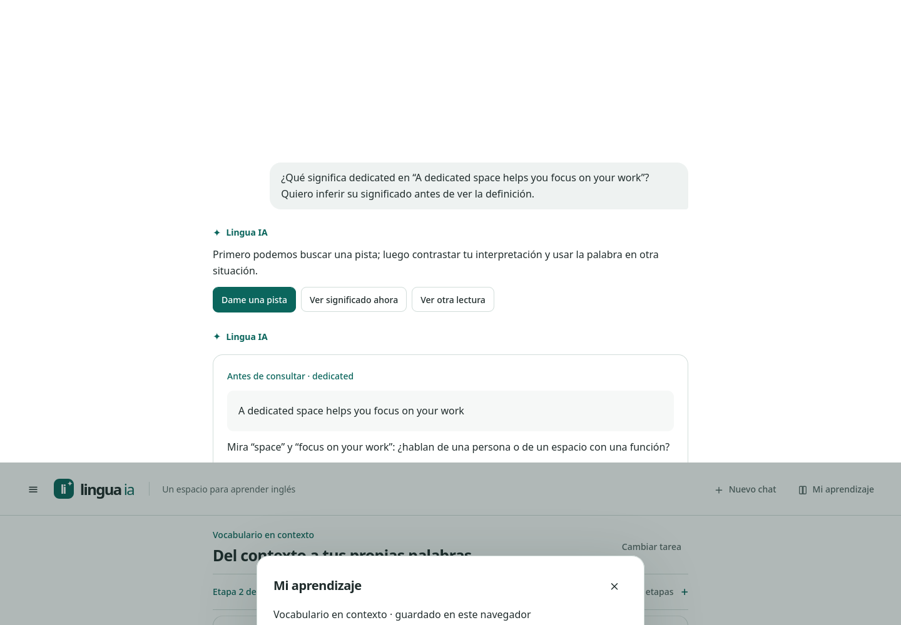
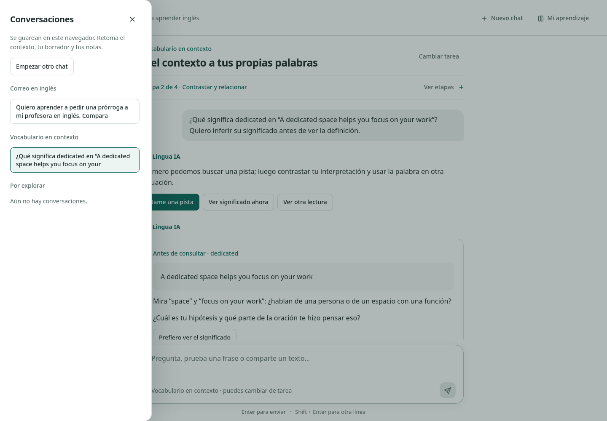
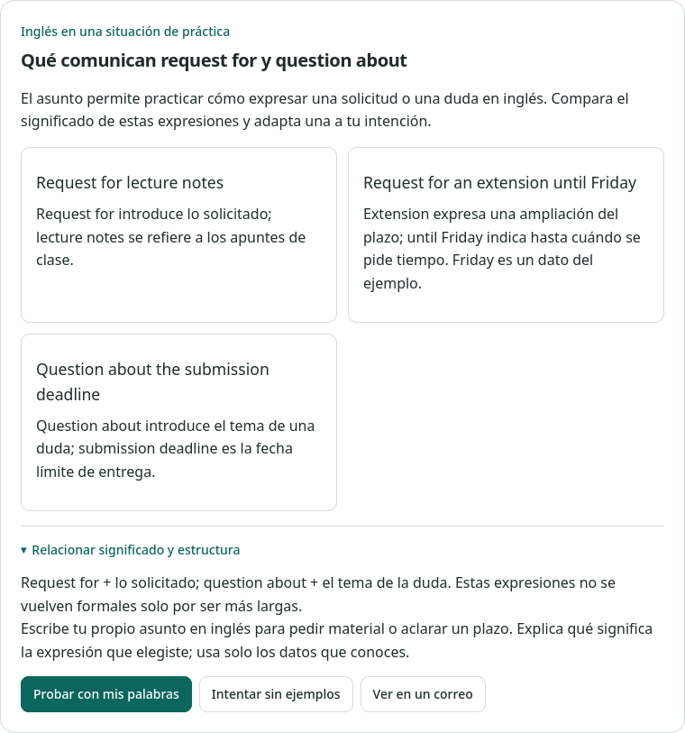
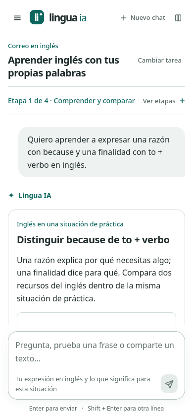
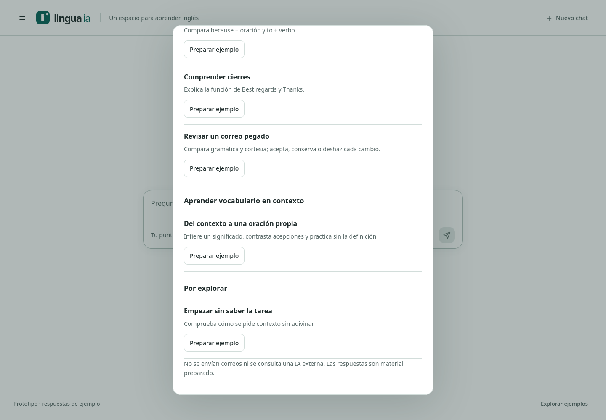

# Guía de principios IHC · interfaz conversacional

Revisión técnica: 26/11/2026 · Correo y vocabulario · Prototipo local

Alumnos: Misael Palomino Rivadeneyra, Jose Alva Cornejo

Documento base: [Matriz en Word](Matriz_reglas_condicion_Lingua_IA.docx) · [Matriz en PDF](Matriz_reglas_condicion_Lingua_IA.pdf).

Fuente principal: Matriz_reglas_condicion_Lingua_IA.docx y su PDF de referencia. Cada entrada conserva el identificador, el nombre, la condición completa y la clasificación original de esa matriz (44 Cumple y 27 No cumple). La valoración actual se hace contra la interfaz vigente y se muestra por separado; no hereda automáticamente el cumplimiento anterior.

Aplicado significa una decisión de diseño inspeccionable que responde a la condición de la matriz; no acredita aprobación docente ni validación experimental. Parcial indica cobertura incompleta, Pendiente una comprobación necesaria, Excluido una decisión de alcance y No aplica la ausencia de la situación descrita. Estas categorías no se cuentan como cumplimiento total.

El HTA v8 describe el proceso general ante contenido o expresiones desconocidos. La interfaz lo ilustra con ejemplos preparados de correo y vocabulario en grupos separados, revisión directa de correos pegados y apoyos de asunto, saludo, petición, razón/finalidad y cierre. Los intentos propios, recuperación y transferencia se registran sin calificar su corrección.

Se corrigieron valoraciones que no respondían a la condición exacta: C3.5 se refiere a números largos y no aplica a esta tarea; C4.3, C6.1 y C7.7 quedan parciales por límites de color, tamaño de texto y competencia entre acciones. Se conserva la clasificación original para que la diferencia sea visible.

La matriz original permanece intacta. Los originales anteriores de la guía están en docs/originales/principios-anterior/. Las capturas vigentes se generan con tools/generate_screenshots.py. Los recorridos y límites de la demo están en guia.md y la correspondencia con el HTA en docs/REVISION_HTA_Y_TRAZABILIDAD.md.

## Resultado de la revisión

| Estado actual | Cantidad |
|---|---:|
| Aplicado | 45 |
| Excluido | 2 |
| Pendiente | 3 |
| Parcial | 9 |
| No aplica | 12 |

La matriz original conserva 44 Cumple y 27 No cumple. La valoración actual no modifica esa fuente ni fuerza que sus 44 casos sigan aplicados; se explican las diferencias por regla. Las pruebas funcionales no acreditan comprensión, accesibilidad completa ni reducción de prompts.

## Recorrido para revisar

1. Abre index.html y escribe una dificultad de inglés: contrasta la sugerencia opcional con C1.3 y C5.1; añádela, edítala o descártala.
2. En Explorar ejemplos comprueba los grupos separados de correo y vocabulario (C3.4 y C8.5). Cada ejemplo prepara un chat independiente sin enviar el mensaje.
3. Pega un correo, incluso con un apoyo pendiente: compara Gramática/Tono, aplica o conserva y deshaz; recupera el original desde Mi aprendizaje (C2.1, C4.5 y C8.2). La revisión es limitada a reglas de ejemplo.
4. Prueba un apoyo lingüístico o vocabulario: escribe una interpretación, contrasta y produce con tus palabras. Intenta recuperar sin ejemplos o definición; consulta apoyo si lo necesitas (C6.2, C7.10 y C8.7).
5. Abre Mi aprendizaje y Conversaciones: comprueba tema, aportes, versiones y ayuda utilizada; retoma después en el mismo navegador (C7.1 y C8.3). Consulta guia.md para los mensajes exactos y los límites.

## Catálogo de los 71 principios

### C1 · La percepción es sesgada

#### C1.1 · Evitar la ambigüedad

- Condición de la matriz: Cada elemento de la interfaz debe tener una sola interpretación plausible para el usuario objetivo.
- Matriz original: **Cumple**. Estado actual: **Aplicado**.
- Evidencia / razón: Acciones con resultado explícito: Añadir a mi mensaje, Conservar mi frase y Recuperar una versión.
- Localización real: `[data-action="use-prompt"]`.
- Captura del escenario: [02_sugerencia.png](docs/screenshots/actual/02_sugerencia.png).

#### C1.2 · Mantener consistencia de ubicación y apariencia

- Condición de la matriz: La misma función debe aparecer en la misma posición, con el mismo color, tipografía, forma y comportamiento en todas las pantallas donde aparezca.
- Matriz original: **Cumple**. Estado actual: **Aplicado**.
- Evidencia / razón: La cabecera permanece visible durante el desplazamiento; el compositor y las acciones conservan estilo y función entre correo y vocabulario.
- Localización real: `.app-header`.
- Captura del escenario: [01_inicio.png](docs/screenshots/actual/01_inicio.png).

#### C1.3 · Diseñar para las metas del usuario

- Condición de la matriz: En cada punto de la interacción, la información necesaria para el objetivo del usuario debe estar disponible, ser prominente y estar claramente ligada a la acción siguiente.
- Matriz original: **Cumple**. Estado actual: **Aplicado**.
- Evidencia / razón: Se comienza con una intención libre y la ayuda se deriva de destinatario, contexto y propósito de aprendizaje.
- Localización real: `#prompt-assist`.
- Captura del escenario: [02_sugerencia.png](docs/screenshots/actual/02_sugerencia.png).

### C2 · La visión está optimizada para ver estructura

#### C2.1 · Proximidad: agrupar lo relacionado

- Condición de la matriz: Los elementos relacionados deben estar más cerca entre sí que de los elementos no relacionados; el espacio en blanco debe separar grupos.
- Matriz original: **Cumple**. Estado actual: **Aplicado**.
- Evidencia / razón: Cada revisión agrupa fragmento, propuesta, motivo y decisión; la consulta léxica conserva su oración.
- Localización real: `.correction-card`.
- Captura del escenario: [04_revision.png](docs/screenshots/actual/04_revision.png).

#### C2.2 · Similitud: mismo aspecto para la misma función

- Condición de la matriz: Los elementos que cumplen la misma función deben parecerse; los que cumplen funciones distintas deben diferenciarse visualmente.
- Matriz original: **Cumple**. Estado actual: **Aplicado**.
- Evidencia / razón: Botones, tarjetas y estados equivalentes reutilizan componentes y estilos.
- Localización real: `.card`.
- Captura del escenario: [04_revision.png](docs/screenshots/actual/04_revision.png).

#### C2.3 · Continuidad: alinear y no interrumpir

- Condición de la matriz: Los elementos deben alinearse siguiendo líneas, columnas o bordes continuos; una secuencia visual no debe interrumpirse sin motivo.
- Matriz original: **Cumple**. Estado actual: **Aplicado**.
- Evidencia / razón: Lectura, comparación y acciones comparten ejes; la ruta mantiene el orden de las sugerencias.
- Localización real: `#stagebar`.
- Captura del escenario: [03_comparar.png](docs/screenshots/actual/03_comparar.png).

#### C2.4 · Cierre: formas simples y reconocibles

- Condición de la matriz: Las formas deben ser lo bastante simples y completas para que el sistema visual las reconozca como un todo, sin exigir contornos perfectos ni detalles innecesarios.
- Matriz original: **Cumple**. Estado actual: **Aplicado**.
- Evidencia / razón: Iconos lineales simples acompañan etiquetas; el envío tiene un nombre accesible.
- Localización real: `#send-btn`.
- Captura del escenario: [01_inicio.png](docs/screenshots/actual/01_inicio.png).

#### C2.5 · Simetría: reducir complejidad

- Condición de la matriz: Los layouts y las tablas deben usar simetría y equilibrio para reducir la complejidad visual y facilitar la comparación.
- Matriz original: **Cumple**. Estado actual: **Aplicado**.
- Evidencia / razón: Columna central y comparaciones de igual peso; en móvil las alternativas se apilan sin perder su asociación.
- Localización real: `.comparison`.
- Captura del escenario: [03_comparar.png](docs/screenshots/actual/03_comparar.png).

#### C2.6 · Figura/fondo: separar planos

- Condición de la matriz: El primer plano debe distinguirse claramente del fondo; modales, overlays y menús deben percibirse como planos separados.
- Matriz original: **Cumple**. Estado actual: **Aplicado**.
- Evidencia / razón: Conversaciones se abre en un panel lateral izquierdo de alto completo; los paneles solicitados usan dialog con fondo separado, foco modal y cierre.
- Localización real: `#workspace-dialog`.
- Captura del escenario: [07_aprendizaje.png](docs/screenshots/actual/07_aprendizaje.png).

#### C2.7 · Destino común: lo que se mueve junto está relacionado

- Condición de la matriz: Los elementos que se mueven juntos se perciben como relacionados; el movimiento debe agrupar lo que pertenece al mismo objeto y separar lo que no.
- Matriz original: **No cumple**. Estado actual: **Excluido**.
- Evidencia / razón: No hay contenido en movimiento que deba agruparse. Se evita añadir animación sin una función de aprendizaje.
- Localización real: `body`.

#### C2.8 · Revisar las agrupaciones combinadas

- Condición de la matriz: La pantalla debe revisarse con todos los principios Gestalt actuando a la vez para detectar agrupaciones, jerarquías o relaciones no intencionadas.
- Matriz original: **No cumple**. Estado actual: **Pendiente**.
- Evidencia / razón: La agrupación se ha inspeccionado en capturas; faltan revisión por dos personas y pruebas de percepción con usuarios.
- Localización real: `.comparison`.

### C3 · Buscamos y usamos estructura visual

#### C3.1 · Presentar información tersa y estructurada

- Condición de la matriz: La información debe presentarse de forma breve y estructurada: listas, tablas o bloques con etiquetas, en lugar de párrafos largos para instrucciones o datos comparables.
- Matriz original: **Cumple**. Estado actual: **Aplicado**.
- Evidencia / razón: Los apoyos lingüísticos se solicitan en el chat; el patrón que conecta significado y estructura se despliega bajo demanda.
- Localización real: `.rule`.
- Captura del escenario: [14_expresiones.png](docs/screenshots/actual/14_expresiones.png).

#### C3.2 · Establecer una jerarquía visual

- Condición de la matriz: La pantalla debe dividirse en secciones y subsecciones con una jerarquía clara de tamaño, prominencia y posición; lo más importante debe estar arriba y tener más peso visual.
- Matriz original: **Cumple**. Estado actual: **Aplicado**.
- Evidencia / razón: La intención precede a los mensajes; las propuestas y acciones se distinguen por tamaño, espacio y contraste.
- Localización real: `.conversation-heading`.
- Captura del escenario: [03_comparar.png](docs/screenshots/actual/03_comparar.png).

#### C3.3 · Usar encabezados semánticos

- Condición de la matriz: Los encabezados deben usar elementos y niveles semánticos reales (`h1`–`h6` o roles equivalentes), de modo que un lector de pantalla pueda navegar por la estructura.
- Matriz original: **No cumple**. Estado actual: **Parcial**.
- Evidencia / razón: Hay encabezados semánticos h1/h2/h3, labels, dialog y log. Falta comprobar toda la interacción con un lector de pantalla real.
- Localización real: `#chat-title`.

#### C3.4 · Agrupar contenido similar

- Condición de la matriz: El contenido del mismo tipo debe compartir estilo visual o estar dentro de un área claramente definida; el contenido de tipos distintos debe separarse.
- Matriz original: **Cumple**. Estado actual: **Aplicado**.
- Evidencia / razón: Explorar ejemplos separa correo, vocabulario y Por explorar en grupos con encabezados; el historial mantiene esas categorías. Elegir un ejemplo prepara otro chat y conserva las demás conversaciones.
- Localización real: `.demo-group`.
- Captura del escenario: [17_ejemplos_separados.png](docs/screenshots/actual/17_ejemplos_separados.png).

#### C3.5 · Agrupar los datos en bloques (chunking)

- Condición de la matriz: Los números largos deben agruparse en partes legibles; la interfaz debe permitir o aplicar separadores y formato.
- Matriz original: **Cumple**. Estado actual: **No aplica**.
- Evidencia / razón: La condición de la matriz trata de separar números largos para hacerlos legibles. La interfaz no presenta ese tipo de dato. Agrupar tarjetas, aportes o métricas no demuestra esta condición.
- Localización real: `.metrics`.

#### C3.6 · Usar campos segmentados cuando reduzcan errores

- Condición de la matriz: Fechas, teléfonos y números compuestos deben dividirse en campos o segmentos cuando eso reduzca ambigüedad y errores de formato.
- Matriz original: **No cumple**. Estado actual: **No aplica**.
- Evidencia / razón: No se piden identificadores, teléfonos ni fechas compuestas. Fragmentar el mensaje libre volvería a introducir el formulario que se quiere evitar.
- Localización real: `#chat-input`.

#### C3.7 · Usar controles específicos para cada tipo de dato

- Condición de la matriz: Los valores con un dominio limitado deben capturarse con controles que impidan datos inválidos: calendario, menús, selectores o controles híbridos.
- Matriz original: **Cumple**. Estado actual: **Aplicado**.
- Evidencia / razón: Los valores limitados de tarea, etapa y decisión se eligen con botones que ofrecen las opciones disponibles; el mensaje, que admite contenido abierto, usa texto libre. No se piden fechas o teléfonos mediante controles genéricos.
- Localización real: `#task-choice`.
- Captura del escenario: [11_etapas.png](docs/screenshots/actual/11_etapas.png).

#### C3.8 · Mantener las etiquetas junto a sus valores

- Condición de la matriz: Cada etiqueta debe estar arriba o a la izquierda de su valor, y la proximidad debe dejar claro a qué dato pertenece; nunca debe estar debajo del valor.
- Matriz original: **Cumple**. Estado actual: **Aplicado**.
- Evidencia / razón: Tu frase, Propuesta y la categoría se encuentran junto a sus valores, también en la comparación léxica.
- Localización real: `.diff-line`.
- Captura del escenario: [04_revision.png](docs/screenshots/actual/04_revision.png).

#### C3.9 · Evitar el ruido en los resultados de búsqueda

- Condición de la matriz: Los resultados de búsqueda deben mostrar información relevante y estructurada, sin repetir navegación, metadatos o texto que dificulte el escaneo.
- Matriz original: **No cumple**. Estado actual: **No aplica**.
- Evidencia / razón: No existe una página de resultados de búsqueda. Las fichas preparadas no se presentan como resultados de una búsqueda.
- Localización real: `.word-detail`.

### C4 · La visión del color es limitada

#### C4.1 · Usar colores distintivos

- Condición de la matriz: Para codificar categorías o estados, se deben preferir colores que producen una señal fuerte en un solo canal: rojo, verde, amarillo, azul, negro y blanco.
- Matriz original: **Cumple**. Estado actual: **Aplicado**.
- Evidencia / razón: Gramática usa azul y Tono usa ocre, con nombres visibles. La decisión no depende del color.
- Localización real: `.badge.grammar`.
- Captura del escenario: [04_revision.png](docs/screenshots/actual/04_revision.png).

#### C4.2 · No yuxtaponer colores opuestos fuertes

- Condición de la matriz: No se deben colocar directamente juntos colores opuestos fuertes (rojo/verde, azul/amarillo) porque producen una sensación de vibración o brillo incómodo.
- Matriz original: **No cumple**. Estado actual: **Aplicado**.
- Evidencia / razón: La revisión utiliza azul y ocre sobre fondos suaves, separados por espacio; no hay rojo y verde saturados yuxtapuestos.
- Localización real: `.badge`.

#### C4.3 · Diferenciar por saturación y brillo, no solo por tono

- Condición de la matriz: Los colores que transmiten información deben diferenciarse por saturación y brillo además del tono; no se deben usar diferencias sutiles de tono.
- Matriz original: **Cumple**. Estado actual: **Parcial**.
- Evidencia / razón: Hay texto, bordes y fondos diferenciados, pero no se ha comprobado que todas las categorías y estados codificados por color se distingan por saturación y brillo además del tono. Las etiquetas redundantes apoyan C4.5 y no sustituyen esta comprobación.
- Localización real: `.badge`.
- Captura del escenario: [04_revision.png](docs/screenshots/actual/04_revision.png).

#### C4.4 · Evitar pares problemáticos para daltonismo

- Condición de la matriz: No se deben usar pares que las personas con daltonismo no distinguen para transmitir información: rojo oscuro/negro, rojo oscuro/verde oscuro, azul/morado y verde claro/blanco.
- Matriz original: **Cumple**. Estado actual: **Aplicado**.
- Evidencia / razón: No se depende del par rojo/verde; categorías y estados se repiten en texto. No equivale a una validación con personas con daltonismo.
- Localización real: `.badge.tone`.
- Captura del escenario: [04_revision.png](docs/screenshots/actual/04_revision.png).

#### C4.5 · No usar color como único canal

- Condición de la matriz: Ningún significado debe depender exclusivamente del color; todo estado o categoría codificada por color debe tener una señal redundante: texto, icono, forma, patrón o posición.
- Matriz original: **Cumple**. Estado actual: **Aplicado**.
- Evidencia / razón: Categoría, antes/después, decisión y estado se expresan mediante rótulos, no solo color.
- Localización real: `.badge`.
- Captura del escenario: [04_revision.png](docs/screenshots/actual/04_revision.png).

#### C4.6 · Asegurar contraste de los elementos no textuales

- Condición de la matriz: Iconos, bordes, controles, indicadores de foco y estados no textuales deben tener contraste suficiente con su fondo para ser perceptibles en condiciones normales.
- Matriz original: **No cumple**. Estado actual: **Parcial**.
- Evidencia / razón: Foco visible de 3 px e iconos oscuros. No se declara una medición exhaustiva de contraste para todos los bordes y estados.
- Localización real: `#send-btn`.

#### C4.7 · Considerar las condiciones externas de visualización

- Condición de la matriz: El uso del color debe funcionar en distintas pantallas, modos, ángulos de visión y condiciones de luz; no se puede depender de un monitor calibrado ni de un único modo.
- Matriz original: **No cumple**. Estado actual: **Pendiente**.
- Evidencia / razón: Falta comprobar pantallas, brillo, reflejos y dispositivos reales del público objetivo. Las capturas de un navegador no sustituyen esa prueba.
- Localización real: `body`.

### C5 · La visión periférica es pobre

#### C5.1 · Colocar la información importante donde mira el usuario

- Condición de la matriz: La información nueva, importante o cambiada debe aparecer en la fóvea o cerca del punto donde el usuario está mirando y actuando, no solo en la periferia.
- Matriz original: **Cumple**. Estado actual: **Aplicado**.
- Evidencia / razón: La sugerencia de consulta aparece junto al compositor y la explicación junto al fragmento que se revisa.
- Localización real: `#prompt-assist`.
- Captura del escenario: [02_sugerencia.png](docs/screenshots/actual/02_sugerencia.png).

#### C5.2 · Mostrar los errores junto a su causa

- Condición de la matriz: El mensaje de error debe aparecer en la zona de atención del usuario y quedar asociado al control que lo causó.
- Matriz original: **No cumple**. Estado actual: **No aplica**.
- Evidencia / razón: No hay errores de validación de formularios. El envío vacío se deshabilita y las limitaciones de revisión aparecen junto al texto.
- Localización real: `#composer-notice`.

#### C5.3 · Marcar el error con símbolo y reservar el rojo

- Condición de la matriz: Los errores deben marcarse con un símbolo estándar además del color; el rojo debe reservarse para errores o alertas y no usarse para información no crítica.
- Matriz original: **No cumple**. Estado actual: **Aplicado**.
- Evidencia / razón: La propuesta gramatical muestra un símbolo y el rótulo Gramática; la elección de tono usa su propia etiqueta. No se emplea rojo para señalar una preferencia estilística.
- Localización real: `.badge.grammar`.

#### C5.4 · Usar señales que “pop” en la periferia

- Condición de la matriz: Para que un elemento destaque en la periferia, se deben usar diferencias que la visión periférica detecta: color, movimiento, peso de fuente o forma gruesa. La forma de una letra o el detalle fino no hacen pop-out.
- Matriz original: **No cumple**. Estado actual: **Excluido**.
- Evidencia / razón: No existen avisos periféricos urgentes. Las sugerencias se sitúan junto a la escritura y pueden ignorarse.
- Localización real: `#prompt-assist`.

#### C5.5 · Reservar los pop-ups para lo crítico

- Condición de la matriz: Los diálogos de error o pop-ups deben usarse solo para condiciones críticas o pérdida de datos; no para confirmaciones menores ni para marketing.
- Matriz original: **No cumple**. Estado actual: **Aplicado**.
- Evidencia / razón: No se abren ventanas automáticas. Los paneles se solicitan expresamente; reglas y explicaciones se despliegan en el mismo contexto.
- Localización real: `.rule`.

#### C5.6 · Usar sonido con moderación

- Condición de la matriz: El sonido puede atraer la atención, pero debe usarse solo en situaciones controladas, con equivalente visual y respetando el silencio del sistema.
- Matriz original: **No cumple**. Estado actual: **No aplica**.
- Evidencia / razón: La práctica seleccionada es textual y no necesita sonidos de alerta ni audio.
- Localización real: `#chat-messages`.

#### C5.7 · Mantener el movimiento o parpadeo breve

- Condición de la matriz: Si se usa movimiento o parpadeo para atraer atención, debe durar aproximadamente 0.25–0.5 segundos y detenerse; nunca debe ser persistente.
- Matriz original: **No cumple**. Estado actual: **No aplica**.
- Evidencia / razón: No hay parpadeos ni animaciones de aviso; no existe una duración de movimiento que limitar.
- Localización real: `body`.

#### C5.8 · Evitar la habituación a las alertas

- Condición de la matriz: Las alertas fuertes (pop-ups, sonidos, movimiento, rojo) deben reservarse para lo crítico; su uso frecuente hace que el usuario las ignore.
- Matriz original: **Cumple**. Estado actual: **Aplicado**.
- Evidencia / razón: Sin sonidos, ventanas automáticas ni avisos repetitivos; la confirmación permanece junto al mensaje.
- Localización real: `#composer-notice`.
- Captura del escenario: [04_revision.png](docs/screenshots/actual/04_revision.png).

#### C5.9 · No mover los ítems de menús, listas o paletas

- Condición de la matriz: Los ítems de menús, listas y paletas deben mantener posiciones estables; no se deben reordenar dinámicamente por frecuencia de uso.
- Matriz original: **Cumple**. Estado actual: **Aplicado**.
- Evidencia / razón: Las categorías del historial mantienen el orden Correo, Vocabulario y Por explorar; las conversaciones conservan su orden de creación.
- Localización real: `.history-group`.
- Captura del escenario: [08_historial.png](docs/screenshots/actual/08_historial.png).

#### C5.10 · Diseñar iconos distintivos para la periferia

- Condición de la matriz: Los iconos deben distinguirse por color y forma gruesa, no por detalles finos, para que puedan reconocerse a tamaño pequeño o en visión periférica.
- Matriz original: **Cumple**. Estado actual: **Aplicado**.
- Evidencia / razón: Iconos de documento, libro, nuevo chat y conversaciones mantienen siluetas diferentes, acompañadas de etiquetas o nombres accesibles.
- Localización real: `.header-actions`.
- Captura del escenario: [01_inicio.png](docs/screenshots/actual/01_inicio.png).

### C6 · Leer no es natural

#### C6.1 · Usar un tamaño de texto legible

- Condición de la matriz: El texto de cuerpo debe poder leerse sin zoom al 100 % en el dispositivo objetivo; el texto esencial no debe estar por debajo del tamaño base del sistema.
- Matriz original: **No cumple**. Estado actual: **Parcial**.
- Evidencia / razón: El cuerpo y el compositor usan 16 px, pero algunas etiquetas y botones de tarea bajan de ese tamaño, sobre todo en móvil. La ausencia de desbordamiento no demuestra que todo el texto esencial respete el tamaño base exigido por la matriz. Falta probar lectura con el público objetivo.
- Localización real: `body`.
- Captura del escenario: [15_razon_finalidad_movil.png](docs/screenshots/actual/15_razon_finalidad_movil.png).

#### C6.2 · Usar lenguaje llano y vocabulario familiar

- Condición de la matriz: La interfaz debe usar palabras familiares para el usuario objetivo, un vocabulario consistente y frases directas; la jerga, las abreviaturas no explicadas y los términos legales innecesarios deben eliminarse o explicarse.
- Matriz original: **Cumple**. Estado actual: **Aplicado**.
- Evidencia / razón: Las expresiones de asunto, saludo, petición, razón/finalidad y cierre aparecen en inglés con explicaciones de significado y uso en español.
- Localización real: `.language-lesson`.
- Captura del escenario: [14_expresiones.png](docs/screenshots/actual/14_expresiones.png).

#### C6.3 · Usar tipografías familiares y legibles

- Condición de la matriz: El texto de cuerpo debe usar tipografías familiares, con formas de letra claras; se deben evitar fuentes decorativas, outline o script para texto largo.
- Matriz original: **Cumple**. Estado actual: **Aplicado**.
- Evidencia / razón: Se usa una tipografía sans serif del sistema sin depender de descargas ni fuentes decorativas para la lectura.
- Localización real: `body`.
- Captura del escenario: [01_inicio.png](docs/screenshots/actual/01_inicio.png).

#### C6.4 · No usar TODO EN MAYÚSCULAS en el cuerpo

- Condición de la matriz: El texto de cuerpo y las instrucciones deben usar mayúsculas y minúsculas; las mayúsculas sostenidas se reservan para etiquetas cortas, siglas o títulos breves.
- Matriz original: **Cumple**. Estado actual: **Aplicado**.
- Evidencia / razón: Títulos e instrucciones utilizan mayúsculas y minúsculas; no hay párrafos en mayúsculas sostenidas.
- Localización real: `#welcome-title`.
- Captura del escenario: [01_inicio.png](docs/screenshots/actual/01_inicio.png).

#### C6.5 · Evitar fondos ruidosos detrás del texto

- Condición de la matriz: El texto debe ir sobre un fondo sólido o lo bastante tranquilo; no se debe colocar texto esencial sobre patrones, imágenes detalladas o gradientes que dificulten el reconocimiento.
- Matriz original: **Cumple**. Estado actual: **Aplicado**.
- Evidencia / razón: Los textos se leen sobre fondos sólidos; no hay imágenes ni patrones detrás de las explicaciones.
- Localización real: `.reading-card`.
- Captura del escenario: [05_vocabulario.png](docs/screenshots/actual/05_vocabulario.png).

#### C6.6 · Asegurar contraste de texto suficiente

- Condición de la matriz: El texto debe tener una relación de contraste de al menos 4.5:1 con su fondo (3:1 para texto grande), en todos los estados.
- Matriz original: **No cumple**. Estado actual: **Parcial**.
- Evidencia / razón: Se usa texto oscuro sobre fondos claros; falta una auditoría completa de todos los pares, estados, zoom y ajustes del usuario. No se afirma conformidad WCAG global.
- Localización real: `body`.

#### C6.7 · No centrar párrafos de texto

- Condición de la matriz: Los párrafos de varias líneas deben alinearse a la izquierda en idiomas LTR y a la derecha en RTL; no se deben centrar ni usar alineación irregular que obligue a recalcular el inicio de cada línea.
- Matriz original: **Cumple**. Estado actual: **Aplicado**.
- Evidencia / razón: Mensajes, correos, lectura y explicaciones se alinean a la izquierda; solo se centran título inicial y metadatos breves.
- Localización real: `.message-content`.
- Captura del escenario: [05_vocabulario.png](docs/screenshots/actual/05_vocabulario.png).

#### C6.8 · Mantener una alineación consistente

- Condición de la matriz: La alineación debe ser consistente dentro de cada bloque y entre bloques equivalentes; no se debe mezclar izquierda, centro y derecha sin una razón de jerarquía.
- Matriz original: **Cumple**. Estado actual: **Aplicado**.
- Evidencia / razón: Las tarjetas equivalentes comparten márgenes y las comparaciones mantienen alineación.
- Localización real: `.comparison`.
- Captura del escenario: [03_comparar.png](docs/screenshots/actual/03_comparar.png).

#### C6.9 · Formatear el texto para escaneo

- Condición de la matriz: El texto debe formatearse para facilitar el escaneo: encabezados, listas, tablas, negritas selectivas y párrafos cortos.
- Matriz original: **Cumple**. Estado actual: **Aplicado**.
- Evidencia / razón: Títulos reales, rótulos, separación y detalles facilitan recorrer original, alternativa y razón.
- Localización real: `.correction-card`.
- Captura del escenario: [04_revision.png](docs/screenshots/actual/04_revision.png).

#### C6.10 · Minimizar la prosa

- Condición de la matriz: La interfaz debe usar la menor cantidad de texto necesaria para que el usuario complete su objetivo; el texto sobrante se elimina, se acorta o se mueve a divulgación progresiva.
- Matriz original: **Cumple**. Estado actual: **Aplicado**.
- Evidencia / razón: El inicio contiene una invitación, un compositor y dos ideas; la ruta y las explicaciones extensas se despliegan a petición.
- Localización real: `#welcome`.
- Captura del escenario: [01_inicio.png](docs/screenshots/actual/01_inicio.png).

#### C6.11 · Eliminar la repetición que entierra información

- Condición de la matriz: Se deben eliminar palabras, líneas o metadatos repetidos que dificulten distinguir la información importante.
- Matriz original: **Cumple**. Estado actual: **Aplicado**.
- Evidencia / razón: No hay panel lateral permanente que repita texto o progreso; la información auxiliar se consulta cuando se necesita.
- Localización real: `#learning-plan`.
- Captura del escenario: [01_inicio.png](docs/screenshots/actual/01_inicio.png).

#### C6.12 · Probar la lectura con usuarios reales

- Condición de la matriz: La legibilidad y la comprensión del texto esencial deben probarse con la población objetivo; si hay captcha, debe ofrecer alternativa legible o no visual.
- Matriz original: **No cumple**. Estado actual: **Pendiente**.
- Evidencia / razón: No se ha realizado una prueba de comprensión y lectura con estudiantes del público objetivo. Las pruebas automáticas no cubren este principio.
- Localización real: `.reading-card`.

### C7 · La atención es limitada; la memoria es imperfecta

#### C7.1 · No exigir recordar el estado o las acciones previas

- Condición de la matriz: La interfaz debe mostrar el estado del sistema, el contexto actual y lo que el usuario ya hizo, en lugar de exigir que lo recuerde.
- Matriz original: **Cumple**. Estado actual: **Aplicado**.
- Evidencia / razón: Contexto, mensajes, borrador y versiones se conservan por conversación y se recuperan desde el historial local.
- Localización real: `.session-link`.
- Captura del escenario: [08_historial.png](docs/screenshots/actual/08_historial.png).

#### C7.2 · Mantener la salida de voz breve y segmentada

- Condición de la matriz: Las interfaces de voz deben limitar la cantidad de información por turno, usar frases cortas y dividir la interacción en segmentos.
- Matriz original: **No cumple**. Estado actual: **No aplica**.
- Evidencia / razón: No hay salida de voz; el contenido se comunica por texto al ritmo del estudiante.
- Localización real: `#chat-messages`.

#### C7.3 · Limitar las listas de opciones en VUI

- Condición de la matriz: Las listas de opciones o resultados por voz no deben superar las 4–5 opciones por turno, salvo que los elementos sean muy familiares.
- Matriz original: **No cumple**. Estado actual: **No aplica**.
- Evidencia / razón: No hay interfaz de voz ni listas de opciones habladas.
- Localización real: `#chat-input`.

#### C7.4 · Apoyar la VUI con salida visual cuando haya pantalla

- Condición de la matriz: Si el dispositivo de voz tiene pantalla, la información debe mostrarse también de forma visual para reducir la carga de memoria.
- Matriz original: **No cumple**. Estado actual: **No aplica**.
- Evidencia / razón: No existe una interfaz de voz que deba acompañarse de salida visual.
- Localización real: `#chat-messages`.

#### C7.5 · Evitar modos o hacer visible el modo actual

- Condición de la matriz: Si una acción produce efectos distintos según el estado del sistema, el modo actual debe ser visible de forma persistente. La opción preferida es no introducir modos.
- Matriz original: **Cumple**. Estado actual: **Aplicado**.
- Evidencia / razón: La tarea y la etapa se muestran en una franja fija; el compositor indica la actividad pendiente. Cambiar tarea permite corregir la clasificación y la recuperación sin ejemplos tiene un aviso persistente. Al abrir un apoyo o revisar un correo se actualiza esa ubicación.
- Localización real: `#task-label`.
- Captura del escenario: [11_etapas.png](docs/screenshots/actual/11_etapas.png).

#### C7.6 · Mostrar los términos de búsqueda en los resultados

- Condición de la matriz: La página de resultados debe mostrar la consulta que los generó y permitir editarla.
- Matriz original: **No cumple**. Estado actual: **No aplica**.
- Evidencia / razón: No existe búsqueda externa ni una página de resultados. El mensaje original sí se conserva en el chat.
- Localización real: `#chat-messages`.

#### C7.7 · Mantener una sola llamada a la acción dominante

- Condición de la matriz: Cada página o pantalla debe tener una llamada a la acción dominante por objetivo; no debe haber varias acciones primarias compitiendo.
- Matriz original: **Cumple**. Estado actual: **Parcial**.
- Evidencia / razón: Enviar y algunos botones de práctica comparten énfasis verde; además pueden permanecer acciones primarias de mensajes anteriores. Hay prioridad local dentro de cada propuesta, pero no se garantiza una única acción dominante en toda la pantalla.
- Localización real: `.primary`.
- Captura del escenario: [14_expresiones.png](docs/screenshots/actual/14_expresiones.png).

#### C7.8 · Preferir una navegación amplia y poco profunda

- Condición de la matriz: La navegación debe organizarse en jerarquías amplias y poco profundas; se deben evitar las jerarquías estrechas y profundas.
- Matriz original: **Cumple**. Estado actual: **Aplicado**.
- Evidencia / razón: Dos ideas de inicio y acceso directo al historial, ruta y notas; no hay un asistente secuencial obligatorio.
- Localización real: `#starter-actions`.
- Captura del escenario: [01_inicio.png](docs/screenshots/actual/01_inicio.png).

#### C7.9 · Mostrar la ruta de navegación (breadcrumbs) en jerarquías profundas

- Condición de la matriz: En jerarquías de más de dos niveles, la interfaz debe mostrar una ruta de navegación que indique dónde está el usuario.
- Matriz original: **No cumple**. Estado actual: **No aplica**.
- Evidencia / razón: La navegación es poco profunda: chat y panel solicitado. El encabezado identifica la actividad sin necesitar una ruta de carpetas.
- Localización real: `#task-label`.

#### C7.10 · No exigir el recuerdo de datos o procedimientos

- Condición de la matriz: La interfaz no debe exigir que el usuario recuerde datos o procedimientos arbitrarios; las instrucciones, los datos y las ayudas deben estar disponibles en el momento de uso.
- Matriz original: **Cumple**. Estado actual: **Aplicado**.
- Evidencia / razón: Reglas, ejemplos y versiones siguen accesibles. La recuperación sin apoyo es una práctica explícita y voluntaria, con opción de consultar.
- Localización real: `#recall-banner`.
- Captura del escenario: [06_recuperar.png](docs/screenshots/actual/06_recuperar.png).

#### C7.11 · Permitir autenticación sin datos arbitrarios

- Condición de la matriz: La autenticación debe permitir preguntas de seguridad creadas por el usuario o métodos alternativos de recuperación, en lugar de imponer datos arbitrarios.
- Matriz original: **No cumple**. Estado actual: **No aplica**.
- Evidencia / razón: El prototipo no administra cuentas, contraseñas ni recuperación de autenticación.
- Localización real: `.app-header`.

### C8 · Los límites de la atención moldean pensamiento y acción

#### C8.1 · Hacer que el software pase a segundo plano

- Condición de la matriz: La interfaz debe permitir que el usuario se concentre en su objetivo, no en la herramienta; el software no debe llamar la atención sobre sí mismo.
- Matriz original: **Cumple**. Estado actual: **Aplicado**.
- Evidencia / razón: La intención, la lectura y la producción propia ocupan el centro. La ruta permanece plegada inicialmente.
- Localización real: `#main`.
- Captura del escenario: [01_inicio.png](docs/screenshots/actual/01_inicio.png).

#### C8.2 · Hacer altamente salientes los cambios importantes

- Condición de la matriz: Los cambios importantes deben ser evidentes: resaltarse, animarse brevemente o anunciarse; no se debe confiar en que el usuario los note por sí solo.
- Matriz original: **Cumple**. Estado actual: **Aplicado**.
- Evidencia / razón: Aplicar, conservar y deshacer un fragmento muestran una confirmación junto al compositor y un estado en la propuesta. Al pegar otro borrador, las propuestas antiguas se identifican como pertenecientes a una versión anterior; no se borran las versiones.
- Localización real: `#composer-notice`.
- Captura del escenario: [04_revision.png](docs/screenshots/actual/04_revision.png).

#### C8.3 · Mostrar lo hecho y lo pendiente

- Condición de la matriz: La interfaz debe indicar qué ha hecho el usuario y qué queda pendiente: leído/no leído, visitado/no visitado, completado/pendiente.
- Matriz original: **Cumple**. Estado actual: **Aplicado**.
- Evidencia / razón: El indicador siempre visible muestra Etapa actual de cuatro. La ruta distingue Actual, Aporte guardado y Sin aporte aún. Cambiar de actividad actualiza la etapa; abrirla no registra una producción ni certifica dominio.
- Localización real: `#stagebar`.
- Captura del escenario: [11_etapas.png](docs/screenshots/actual/11_etapas.png).

#### C8.4 · Permitir marcar, mover o colorear elementos

- Condición de la matriz: La interfaz debe permitir que el usuario marque, mueva, etiquete o coloree elementos para indicar qué ya trabajó y qué no.
- Matriz original: **No cumple**. Estado actual: **Parcial**.
- Evidencia / razón: Se pueden guardar y retirar palabras del repaso. No se añaden colores personales ni reordenamiento de elementos; no es necesario para demostrar las dos tareas.
- Localización real: `[data-action="save-word"]`.

#### C8.5 · Proporcionar un rastro de información claro (information scent)

- Condición de la matriz: En cada punto de decisión, las opciones deben indicar claramente a qué objetivo llevan; cada objetivo importante debe tener un camino visible.
- Matriz original: **Cumple**. Estado actual: **Aplicado**.
- Evidencia / razón: Los grupos distinguen aprender inglés con correo y aprender vocabulario. Preparar ejemplo anticipa un mensaje editable, y Revisar un correo pegado, Probar con mis palabras e Intentar sin ejemplos describen objetivos diferentes.
- Localización real: `[data-action="load-demo"]`.
- Captura del escenario: [17_ejemplos_separados.png](docs/screenshots/actual/17_ejemplos_separados.png).

#### C8.6 · Usar verbos específicos en las confirmaciones

- Condición de la matriz: Los botones de confirmación deben usar verbos específicos que describan la acción y su consecuencia, no “OK” y “Cancelar” genéricos.
- Matriz original: **Cumple**. Estado actual: **Aplicado**.
- Evidencia / razón: Confirmaciones y decisiones usan verbos concretos, incluida la acción de deshacer o usar una versión.
- Localización real: `[data-action="undo-correction"]`.
- Captura del escenario: [04_revision.png](docs/screenshots/actual/04_revision.png).

#### C8.7 · Diseñar caminos y conceptos basados en la tarea

- Condición de la matriz: El software debe ofrecer caminos claros y usar conceptos y acciones basados en la tarea del usuario, no en la implementación interna.
- Matriz original: **Cumple**. Estado actual: **Aplicado**.
- Evidencia / razón: Los caminos usan conceptos del aprendizaje: comprender una expresión, comparar, producir, revisar, recordar y reutilizar. Pegar un correo permite revisar directamente; los ejemplos son casos del HTA general y no obligan a seguir una secuencia fija.
- Localización real: `#learning-plan`.
- Captura del escenario: [14_expresiones.png](docs/screenshots/actual/14_expresiones.png).

#### C8.8 · Dar feedback, progreso y opción de volver atrás

- Condición de la matriz: La interfaz debe mostrar el progreso hacia la meta, confirmar los resultados y permitir volver atrás o deshacer.
- Matriz original: **No cumple**. Estado actual: **Parcial**.
- Evidencia / razón: Hay confirmaciones, notas persistentes y reversión de decisiones y versiones. No existe deshacer global de mensajes o todas las acciones; no se declara cumplimiento total.
- Localización real: `[data-action="undo-correction"]`.

#### C8.9 · Preferir caminos familiares y mostrar atajos

- Condición de la matriz: La interfaz debe apoyar los caminos familiares y los hábitos del usuario, y mostrar atajos para que los expertos puedan acelerar sin perder la comprensión.
- Matriz original: **No cumple**. Estado actual: **Aplicado**.
- Evidencia / razón: Se usan Enter para enviar, Shift+Enter para otra línea y Escape nativo para cerrar dialog. El compositor muestra los atajos familiares.
- Localización real: `.composer-footnote`.

#### C8.10 · Gestionar los pasos de cierre

- Condición de la matriz: La interfaz debe recordar o automatizar los pasos que el usuario tiende a olvidar al terminar la tarea principal.
- Matriz original: **Cumple**. Estado actual: **Aplicado**.
- Evidencia / razón: El cierre es una acción explícita en Mi aprendizaje: resume actividad, permite descargar notas y dejar una duda para retomar. No declara una tarea dominada por navegar hasta el final.
- Localización real: `[data-action="finish"]`.
- Captura del escenario: [07_aprendizaje.png](docs/screenshots/actual/07_aprendizaje.png).

#### C8.11 · Revertir automáticamente los modos especiales

- Condición de la matriz: Los modos especiales deben volver al estado normal automáticamente, por tiempo o por liberación, o recordar de forma persistente que siguen activos.
- Matriz original: **No cumple**. Estado actual: **Parcial**.
- Evidencia / razón: La práctica sin modelo se indica de forma explícita y permite salir con Consultar el apoyo anterior. No expira por tiempo: una salida automática interrumpiría la recuperación al ritmo del estudiante.
- Localización real: `#recall-banner`.

## Evidencias visuales actuales

## Límites de la evaluación

Las fichas, escenarios y reglas son material de demostración, no consultas a una IA o diccionario en vivo. Las fechas de aportes son registros locales; la adquisición de conocimiento debe evaluarse mediante explicaciones, transferencia y recuperación posterior con usuarios. No se declara una mejora medida de consultas, tiempo, tokens ni aprendizaje.
