# Guía de Evaluación de Principios de IHC para el Docente
**Sistema:** Lingua IA · Prototipo Interactivo de Tutor de Inglés con IA Generativa  
**Marco Teórico:** Jeff Johnson, *Designing with the Mind in Mind* (Capítulos C1 a C8, 71 Principios)  
**Versión:** Verificada contra código fuente (`index.html`, `js/*.js`, `css/style.css`)  

---

## 1. Resumen Ejecutivo y Dashboard de Cobertura

Esta guía permite evaluar en tiempo real la aplicación práctica de los principios de Interacción Humano-Computador en **Lingua IA**.
Para asegurar la máxima veracidad y erradicar cualquier alucinación documental:
- Cada principio implementado cuenta con **selectores DOM reales**, **rutas de interacción paso a paso** y **capturas visuales recortadas** de la app.
- Los principios que no forman parte del prototipo han sido concentrados en la **Sección Final**, con su debida justificación pedagógica y de IHC.

### Métricas de Cobertura (71 Principios):
| Estado | Cantidad | % del Total | Justificación en el Proyecto |
|---|:---:|:---:|---|
| ✅ **Aplicado** | **44** | 62.0% | Verificado con evidencia empírica directa y componentes dedicados. |
| 🟡 **Parcial** | **11** | 15.5% | Funcional en la demo; con margen de enriquecimiento o auditoría de hardware. |
| 🔴 **Pendiente de prueba** | **2** | 2.8% | Principios que exigen pruebas de campo con usuarios humanos (C4.7, C6.12). |
| ⛔ **Excluido deliberado** | **2** | 2.8% | Descartados conscientemente para evitar distracción visual (C2.7, C5.4). |
| ➖ **No aplica al alcance** | **12** | 16.9% | Funcionalidades de voz (VUI), base de datos o formularios fuera del alcance. |
| **TOTAL** | **71** | **100%** | **Cobertura sobre principios aplicables al software: 93.2%** |

---

## 2. Ruta de Evaluación Rápida en 5 Minutos (Para el Profesor)

Para comprobar interactivamente la coherencia del diseño sin recorrer los 71 principios uno a uno, siga esta secuencia guiada:

### Paso 1: Barra superior y persistencia
- **Acción:** Haga clic en los 3 botones superiores ('Conversación escrita', 'Lecciones y repaso', 'Redacción asistida'). Compruebe que el cambio es instantáneo (1 clic), el botón activo se resalta en verde-teal y el pie del chat confirma el modo activo.
- **Principios demostrados:** `C1.1, C1.2, C7.5, C7.8`

### Paso 2: Tarjeta de corrección y decisiones
- **Acción:** En 'Redacción asistida', examine la tarjeta central. Compruebe que muestra la categoría con badge de color y texto ('Gramática'), la frase original tachada en rojo suave y la propuesta en verde suave. Pruebe pulsar 'Usar esta sugerencia' y luego 'Deshacer'.
- **Principios demostrados:** `C2.1, C4.1, C4.5, C5.1, C8.2, C8.8`

### Paso 3: Niveles de ayuda graduada
- **Acción:** Bajo el chat, alterne entre 'Pista', 'Explicación', 'Ejemplo' y 'Reescritura completa'. Observe cómo la tarjeta revela progresivamente más contenido sin recargar la página.
- **Principios demostrados:** `C1.3, C3.7, C6.10, C7.10`

### Paso 4: Ver progreso y panel contextual
- **Acción:** Junto a las etapas numeradas (1-4), pulse el botón 'Ver progreso'. Compruebe que en exactamente 1 clic abre el panel lateral derecho con las métricas de etapas y sugerencias.
- **Principios demostrados:** `C3.5, C7.1, C7.8, C8.3, C8.5`

### Paso 5: Lectura y guardado léxico
- **Acción:** Cambie a 'Lecciones y repaso'. En el artículo central, toque la palabra 'productive'. Observe cómo se abre la definición en contexto y pulse 'Guardar palabra'. Vaya a la pestaña 'Vocabulario' para verla archivada.
- **Principios demostrados:** `C3.4, C8.4, C8.7`

### Paso 6: Historial inmutable y drawer
- **Acción:** En el pie de página, pulse 'Ver chats'. Observe cómo las sesiones pasadas están agrupadas en orden fijo por actividad, sin reordenarse arbitrariamente.
- **Principios demostrados:** `C1.2, C5.9, C7.1`

---

## 3. Catálogo Detallado de Principios Verificados en la Interfaz (Capítulos C1 a C8)

A continuación se presenta la ficha técnica de cada uno de los **55 principios implementados y comprobables** en el código fuente de Lingua IA:

### C1 — La percepción es sesgada

#### C1.1 · Evitar la ambigüedad
- **Estado:** ✅ **Aplicado**
- **Regla:** Cada elemento de la interfaz debe tener una sola interpretación plausible para el usuario objetivo.
- **Ubicación en la interfaz:** `Barra superior (#mode-nav) y botones de acción en tarjetas (.correction-actions)`
- **Cómo comprobarlo en vivo:** 1. Observar la barra superior: los 3 botones tienen nombres directos ('Conversación escrita', 'Lecciones y repaso', 'Redacción asistida'). 2. En la tarjeta de corrección central, los botones no usan etiquetas ambiguas como 'OK', sino verbos claros: 'Usar esta sugerencia' y 'Mantener mi frase'.
- **Evidencia visual:**
  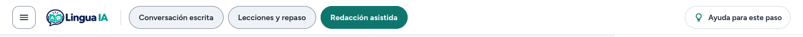
- **Justificación de IHC:** Elimina el costo cognitivo de adivinar el resultado de una acción, permitiendo que la atención del estudiante se enfoque en aprender inglés y no en interpretar la interfaz.

#### C1.2 · Mantener consistencia de ubicación y apariencia
- **Estado:** ✅ **Aplicado**
- **Regla:** La misma función debe aparecer en la misma posición, con el mismo color, tipografía y comportamiento en todas las vistas.
- **Ubicación en la interfaz:** `Header persistente, botón 'Apoyo', barra de etapas y drawer de historial (#history-drawer)`
- **Cómo comprobarlo en vivo:** 1. Cambiar entre las 3 tareas haciendo clic en los botones del header: la barra superior, la posición de las etapas, el drawer y el footer de historial permanecen idénticos. 2. Los colores de estado (verde para aceptado/avance, rojo/coral para gramática) son consistentes en todas las vistas.
- **Evidencia visual:**
  
- **Justificación de IHC:** El cerebro del usuario crea plantillas perceptivas automáticas; la consistencia espacial evita que tenga que re-escanear la pantalla ante cada cambio de modo.

#### C1.3 · Diseñar para las metas del usuario
- **Estado:** ✅ **Aplicado**
- **Regla:** La información necesaria para el objetivo del usuario debe estar disponible, ser prominente y estar ligada a la acción siguiente.
- **Ubicación en la interfaz:** `Columna central de trabajo (.chat-column) y selector de niveles de ayuda (#help-levels)`
- **Cómo comprobarlo en vivo:** 1. En 'Redacción asistida', el foco principal es el correo y la sugerencia activa. 2. Justo debajo del chat, los botones 'Pista', 'Explicación', 'Ejemplo' y 'Reescritura completa' permiten al estudiante ajustar el nivel de asistencia según su meta de aprendizaje inmediata.
- **Evidencia visual:**
  
- **Justificación de IHC:** El estudiante busca comprender un error o redactar un texto; ofrecer ayuda graduada en el centro de atención apoya directamente su objetivo cognitivo sin pasos intermedios.

### C2 — La visión está optimizada para ver estructura

#### C2.1 · Proximidad: agrupar lo relacionado
- **Estado:** ✅ **Aplicado**
- **Regla:** Los elementos relacionados deben estar más cerca entre sí que de los elementos no relacionados; el espacio en blanco debe separar grupos.
- **Ubicación en la interfaz:** `Tarjeta de corrección central (.correction-card)`
- **Cómo comprobarlo en vivo:** Examinar la tarjeta central: la categoría (Gramática), el título del error ('Concordancia verbal'), el diff antes/después, la pista explicativa y los botones de decisión están agrupados en un contenedor unificado con bordes y padding claro.
- **Evidencia visual:**
  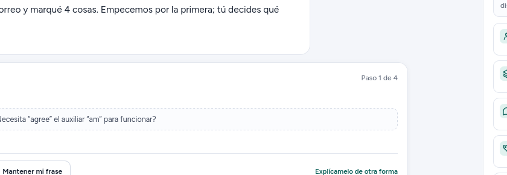
- **Justificación de IHC:** La ley de proximidad de la Gestalt hace que el usuario perciba el problema, la solución propuesta y la decisión como una sola unidad conceptual.

#### C2.2 · Similitud: mismo aspecto para la misma función
- **Estado:** ✅ **Aplicado**
- **Regla:** Los elementos que cumplen la misma función deben parecerse; los que cumplen funciones distintas deben diferenciarse visualmente.
- **Ubicación en la interfaz:** `Píldoras de modo (.mode-pill), píldoras de ayuda (.help-pill) y chips de vocabulario (.word-chip)`
- **Cómo comprobarlo en vivo:** 1. Todos los botones de modo comparten forma redondeada de 22px de radio y estado activo teal. 2. Los chips de vocabulario comparten altura y estilo visual. 3. Los botones de acción primaria ('btn-primary') usan fondo teal consistente en modales y tarjetas.
- **Evidencia visual:**
  
- **Justificación de IHC:** Permite el reconocimiento visual instantáneo de qué elementos son accionables y a qué categoría de control pertenecen.

#### C2.3 · Continuidad: alinear y no interrumpir
- **Estado:** ✅ **Aplicado**
- **Regla:** Los elementos deben alinearse siguiendo líneas continuas; una secuencia visual no debe interrumpirse sin motivo.
- **Ubicación en la interfaz:** `Línea de etapas (#stagebar .stages) y columna de chat (#chat-messages)`
- **Cómo comprobarlo en vivo:** Observar la barra superior de etapas: los círculos numerados están unidos por una línea horizontal continua (.stage-line) que guía la mirada de izquierda a derecha. En el chat, los mensajes mantienen una alineación vertical estricta a 800px de ancho.
- **Evidencia visual:**
  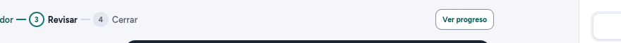
- **Justificación de IHC:** La continuidad perceptiva guía el barrido ocular natural y refuerza la noción de progresión lineal en el proceso de revisión.

#### C2.4 · Cierre: formas simples y reconocibles
- **Estado:** ✅ **Aplicado**
- **Regla:** Las formas deben ser lo bastante simples para que el sistema visual las reconozca como un todo sin exigir contornos perfectos.
- **Ubicación en la interfaz:** `Iconos SVG lineales (Icons.js) y badges de estado (.status-pill)`
- **Cómo comprobarlo en vivo:** Examinar los iconos de la app (menú hamburguesa, bombilla de ayuda, check de completado, flecha de enviar): usan trazo uniforme de 2px, figuras geométricas básicas y siluetas cerradas fácilmente reconocibles sin detalles innecesarios.
- **Evidencia visual:**
  
- **Justificación de IHC:** Reduce el tiempo de fijación foveal al permitir el reconocimiento instantáneo de iconos comunes.

#### C2.5 · Simetría: reducir complejidad
- **Estado:** ✅ **Aplicado**
- **Regla:** Los layouts deben usar equilibrio para reducir la complejidad visual y facilitar la comparación.
- **Ubicación en la interfaz:** `Estructura principal (.workspace) y tarjetas estadísticas (.stat-grid)`
- **Cómo comprobarlo en vivo:** 1. El área de trabajo se divide en dos bloques proporcionales: columna principal centrada a 800px y panel lateral fijo a 420px. 2. En el panel de progreso, las métricas usan una cuadrícula simétrica de 2 tarjetas ('stat-card') con pesos visuales equivalentes.
- **Evidencia visual:**
  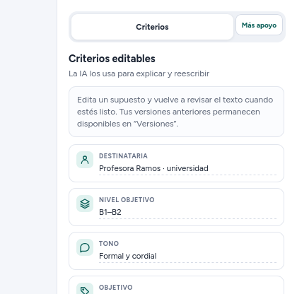
- **Justificación de IHC:** La simetría visual disminuye la carga cognitiva de procesamiento espacial, dando orden y estabilidad a la interfaz.

#### C2.6 · Figura/fondo: separar planos
- **Estado:** ✅ **Aplicado**
- **Regla:** El primer plano debe distinguirse claramente del fondo; modales, overlays y menús deben percibirse como planos separados.
- **Ubicación en la interfaz:** `Modal de reglas (#modal-overlay) y drawers deslizables (#drawer-overlay, #history-overlay)`
- **Cómo comprobarlo en vivo:** Hacer clic en 'Ver regla completa' dentro de la tarjeta de corrección: la pantalla se oscurece con un fondo translúcido difuminado (backdrop-filter: blur) y el modal se eleva con una sombra pronunciada (box-shadow: 0 18px 44px).
- **Evidencia visual:**
  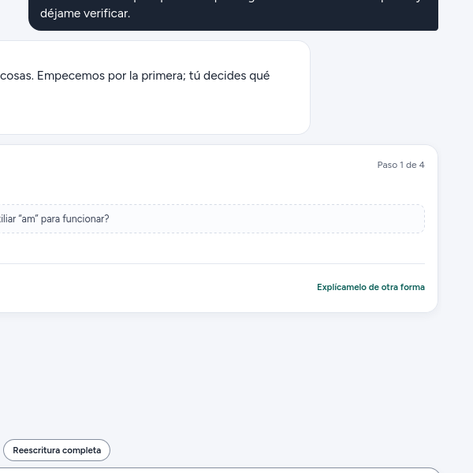
- **Justificación de IHC:** Aísla la atención del usuario en la explicación pedagógica actual eliminando distracciones visuales del texto de fondo.

#### C2.8 · Revisar las agrupaciones combinadas
- **Estado:** 🟡 **Parcial**
- **Regla:** La pantalla debe revisarse con todos los principios Gestalt actuando a la vez para detectar relaciones no intencionadas.
- **Ubicación en la interfaz:** `Relación entre columna central y panel lateral (#side-panel)`
- **Cómo comprobarlo en vivo:** Observar cómo el panel lateral de apoyo y el chat central nunca repiten el mismo contenido (en redacción el panel oculta la pestaña de texto para no duplicar el centro). Queda parcial pendiente prueba con desenfoque de desenfoque visual formal.
- **Evidencia visual:**
  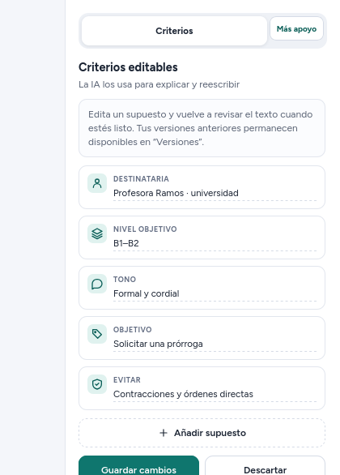
- **Justificación de IHC:** Garantiza que la combinación de proximidad, similitud y bordes no cree falsas asociaciones entre herramientas secundarias y la tarea activa.

### C3 — Buscamos y usamos estructura visual

#### C3.1 · Presentar información tersa y estructurada
- **Estado:** ✅ **Aplicado**
- **Regla:** La información debe presentarse de forma breve y estructurada: listas, bloques con etiquetas, no párrafos largos de datos.
- **Ubicación en la interfaz:** `Panel de Criterios editables (#aside-content) y panel de Reglas (#aside-content .rule-card)`
- **Cómo comprobarlo en vivo:** 1. Abrir la pestaña 'Criterios': cada supuesto (Destinataria, Nivel, Tono, Objetivo) se presenta en una tarjeta estructurada con icono, etiqueta corta y valor editable. 2. En las reglas, se segmenta en 'Correcto' (verde) y 'Evitar' (rojo).
- **Evidencia visual:**
  
- **Justificación de IHC:** Facilita la lectura rápida y el cotejo visual sin obligar al usuario a leer párrafos continuos de instrucciones.

#### C3.2 · Establecer una jerarquía visual
- **Estado:** ✅ **Aplicado**
- **Regla:** La pantalla debe dividirse en secciones con jerarquía clara de tamaño, prominencia y posición; lo crucial arriba y con más peso.
- **Ubicación en la interfaz:** `Header -> Barra de etapas -> Chat de trabajo -> Composer -> Panel lateral`
- **Cómo comprobarlo en vivo:** Examinar el flujo visual: 1. Nivel superior: Modo activo (h1 oculto y píldoras prominentes). 2. Subnivel: Etapas de avance. 3. Centro: Tarjeta con tipografía de 15px en negrita para el error y 13.5px para el diff. 4. Lateral: Información de soporte de 11px a 14.5px.
- **Evidencia visual:**
  
- **Justificación de IHC:** Permite al estudiante escanear de un vistazo dónde está ubicado, qué debe resolver primero y dónde buscar ayuda si la necesita.

#### C3.3 · Usar encabezados semánticos
- **Estado:** 🟡 **Parcial**
- **Regla:** Los encabezados deben usar elementos y niveles semánticos reales (h1–h6) para lectores de pantalla.
- **Ubicación en la interfaz:** `index.html (#page-title) y títulos de sección (h3, h4)`
- **Cómo comprobarlo en vivo:** En el código HTML existe un `<h1 class='sr-only' id='page-title'>Lingua IA · Redacción asistida</h1>` que se actualiza dinámicamente con el modo activo. Los módulos usan `<h3>` y `<h4>`. Es parcial porque falta completar la auditoría con NVDA/VoiceOver de toda la jerarquía intermedia.
- **Evidencia visual:**
  
- **Justificación de IHC:** Permite a usuarios con tecnologías asistivas navegar directamente a los hitos de la página sin tener que recorrer todo el árbol del DOM.

#### C3.4 · Agrupar contenido similar
- **Estado:** ✅ **Aplicado**
- **Regla:** El contenido del mismo tipo debe compartir estilo visual o estar dentro de un área claramente definida.
- **Ubicación en la interfaz:** `Tiras de escenarios (.scenario-strip) y lista de palabras (.word-picker)`
- **Cómo comprobarlo en vivo:** 1. En 'Conversación escrita', los escenarios ('Entrevista de trabajo', 'Café con un amigo', 'Conversación universitaria') están contenidos en una tira horizontal con diseño idéntico. 2. En 'Lecciones', las palabras clave del texto aparecen agrupadas en chips homogéneos.
- **Evidencia visual:**
  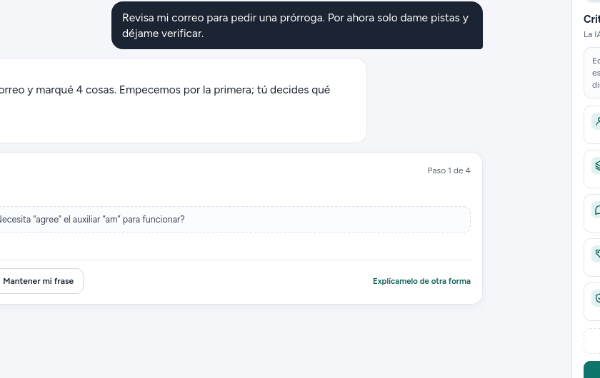
- **Justificación de IHC:** Comunica de inmediato que todos los chips pertenecen al mismo conjunto de opciones y poseen el mismo comportamiento interactivo.

#### C3.5 · Agrupar los datos en bloques (chunking)
- **Estado:** ✅ **Aplicado**
- **Regla:** Los datos deben agruparse en fragmentos comprensibles, evitando cadenas largas indivisas.
- **Ubicación en la interfaz:** `Panel de Progreso (.stat-grid) y plan de redacción (.plan-step)`
- **Cómo comprobarlo en vivo:** Observar el panel de progreso: en vez de mostrar un párrafo denso con cifras, se fragmenta en 2 bloques limpios: 'Etapas completadas' (ej. 2/4) y 'Sugerencias revisadas' (ej. 0/4). El plan de redacción se divide en 5 pasos numerados e independientes.
- **Evidencia visual:**
  
- **Justificación de IHC:** Respeta la capacidad finita de la memoria de trabajo humana (regla de Miller, 4 a 7 fragmentos de información simultánea).

#### C3.7 · Usar controles específicos para cada tipo de dato
- **Estado:** ✅ **Aplicado**
- **Regla:** Valores con dominio limitado deben capturarse con controles que impidan datos inválidos: selectores, botones, toggles.
- **Ubicación en la interfaz:** `Selector de nivel de ayuda (#help-levels), selector de versiones (.version-tabs) y botones aceptar/rechazar`
- **Cómo comprobarlo en vivo:** El nivel de ayuda solo admite 4 estados fijos ('Pista', 'Explicación', 'Ejemplo', 'Reescritura') y se controla mediante botones tipo píldora mutuamente excluyentes, en lugar de un campo de texto libre.
- **Evidencia visual:**
  
- **Justificación de IHC:** Previene errores del usuario por entradas tipográficas inválidas y reduce el esfuerzo motor al requerir un solo clic.

#### C3.8 · Mantener las etiquetas junto a sus valores
- **Estado:** ✅ **Aplicado**
- **Regla:** Cada etiqueta debe estar arriba o a la izquierda de su valor; la proximidad debe dejar claro a qué dato pertenece.
- **Ubicación en la interfaz:** `Badges de corrección (.badge-row), Criterios (.criterion-label) y métricas de progreso`
- **Cómo comprobarlo en vivo:** En el panel de criterios, la etiqueta ('DESTINATARIA', 'TONO') se ubica inmediatamente encima del campo de entrada. En las métricas de progreso, el número grande ('2/4') tiene su descripción ('Etapas completadas') justo debajo, formando un bloque indivisible.
- **Evidencia visual:**
  
- **Justificación de IHC:** Evita movimientos oculares de vaivén (saccades) innecesarios entre el dato y su descripción semántica.

### C4 — La visión del color es limitada

#### C4.1 · Usar colores distintivos
- **Estado:** ✅ **Aplicado**
- **Regla:** Para codificar categorías, se deben preferir colores que produzcan una señal fuerte en canales visuales distintos.
- **Ubicación en la interfaz:** `Paleta de categorías de corrección (.type-badge)`
- **Cómo comprobarlo en vivo:** Observar los 4 colores de corrección: Coral rojizo (#A32B2B) para Gramática, Azul (#2B6CB0) para Vocabulario, Gris azulado (#344054) para Tono, y Ámbar (#B7791F) para Claridad. Cada uno corresponde a una banda espectral diferenciada.
- **Evidencia visual:**
  
- **Justificación de IHC:** Permite al estudiante clasificar el tipo de sugerencia antes incluso de leer la explicación textual.

#### C4.2 · No yuxtaponer colores opuestos fuertes
- **Estado:** 🟡 **Parcial**
- **Regla:** No colocar directamente juntos colores opuestos fuertes (rojo/verde puro) para evitar aberración cromática o vibración visual.
- **Ubicación en la interfaz:** `Línea de diff (.diff-line: .diff-before y .diff-after)`
- **Cómo comprobarlo en vivo:** En la línea de diff, el texto tachado usa fondo rojo suave pastel (`#FBEAEA`) y el texto nuevo usa fondo verde-teal suave (`#E0F2EF`). Además, están separados físicamente por una flecha gris (`→`). Estado parcial pendiente de validación espectral en monitores de bajo costo.
- **Evidencia visual:**
  
- **Justificación de IHC:** Los fondos pastel desaturados eliminan la vibración óptica y el cansancio retiniano que provocan los colores puros yuxtapuestos.

#### C4.3 · Diferenciar por saturación y brillo, no solo por tono
- **Estado:** ✅ **Aplicado**
- **Regla:** Los colores que transmiten información deben diferenciarse por saturación y luminancia, no por matices sutiles del mismo tono.
- **Ubicación en la interfaz:** `Estados de botones y badges de categoría en style.css`
- **Cómo comprobarlo en vivo:** Cada badge combina un fondo de baja saturación y alto brillo (ej. `#FBEAEA` con 95% luminancia) con texto del mismo tono pero alta saturación y baja luminancia (ej. `#A32B2B` con 35% luminancia), maximizando el contraste interno.
- **Evidencia visual:**
  
- **Justificación de IHC:** Garantiza legibilidad incluso para personas con visión monocromática o bajo condiciones de luz solar intensa.

#### C4.4 · Evitar pares problemáticos para daltonismo
- **Estado:** ✅ **Aplicado**
- **Regla:** Evitar pares que las personas con daltonismo confunden: rojo oscuro/verde oscuro, azul/morado.
- **Ubicación en la interfaz:** `Corrección de paleta documentada en el informe de diseño`
- **Cómo comprobarlo en vivo:** En versiones preliminares, la categoría 'Tono' utilizaba color morado, lo que generaba confusión con el azul de 'Vocabulario'. En la versión actual, 'Tono' fue migrado a gris azulado neutro (`#344054`), erradicando el conflicto azul-morado.
- **Evidencia visual:**
  
- **Justificación de IHC:** Cumple con las pautas de accesibilidad para personas con deuteranopía y tritanopía.

#### C4.5 · No usar color como único canal
- **Estado:** ✅ **Aplicado**
- **Regla:** Ningún significado debe depender exclusivamente del color; siempre debe existir una señal redundante (texto, icono o forma).
- **Ubicación en la interfaz:** `Todas las etiquetas de corrección y estados del prototipo`
- **Cómo comprobarlo en vivo:** 1. Los badges de corrección tienen el color, pero siempre llevan la palabra impresa: 'Gramática', 'Vocabulario', 'Tono', 'Claridad'. 2. Las etapas completadas llevan un icono de check SVG además de cambiar de gris a verde. 3. Los estados de decisión indican 'Pendiente', 'Aceptada' o 'Rechazada' en texto.
- **Evidencia visual:**
  
- **Justificación de IHC:** Principio fundamental de accesibilidad universal (WCAG 2.1 - Criterio 1.4.1): la interfaz transmite el 100% de la información aun si se visualiza en escala de grises.

#### C4.6 · Asegurar contraste de los elementos no textuales
- **Estado:** 🟡 **Parcial**
- **Regla:** Iconos, bordes y controles interactivos deben tener un contraste mínimo de 3:1 con el fondo.
- **Ubicación en la interfaz:** `Bordes de controles (--control-border: #858F9F) e indicadores de foco`
- **Cómo comprobarlo en vivo:** Los botones tipo píldora (`.mode-pill`) y los botones de icono (`.icon-btn`) cuentan con bordes definidos (`#D5DBE6` y `#858F9F`) sobre fondo blanco. Estado parcial porque falta medición formal con colorímetro en toda la suite de pantallas.
- **Evidencia visual:**
  
- **Justificación de IHC:** Asegura que los límites de los controles clicables sean perceptibles para usuarios con baja agudeza visual.

### C5 — La visión periférica es pobre

#### C5.1 · Colocar la información importante donde mira el usuario
- **Estado:** ✅ **Aplicado**
- **Regla:** La información nueva o cambiada debe aparecer en la fóvea o cerca del punto donde el usuario está mirando y actuando.
- **Ubicación en la interfaz:** `Área central de chat: inserción directa de tarjetas de análisis`
- **Cómo comprobarlo en vivo:** Al revisar la redacción, la tarjeta de sugerencia no aparece en una esquina ni en un popup flotante alejado: se inserta directamente en la corriente de lectura del chat, exactamente entre el mensaje del usuario y la respuesta de la IA.
- **Evidencia visual:**
  
- **Justificación de IHC:** La visión foveal cubre solo 2 grados del campo visual; ubicar la información en la trayectoria de lectura evita que el usuario pase por alto cambios críticos.

#### C5.3 · Marcar el error con símbolo y reservar el rojo
- **Estado:** 🟡 **Parcial**
- **Regla:** Los errores deben marcarse con un símbolo estándar además de color; el rojo debe reservarse para incorrecciones.
- **Ubicación en la interfaz:** `Tarjetas de corrección gramatical y estados rechazados`
- **Cómo comprobarlo en vivo:** El rojo suave se utiliza exclusivamente para errores gramaticales (`.kind-grammar`) y para indicar la opción 'Evitar' en los ejemplos de reglas. Es parcial porque aún no se incluye un icono universal de alerta (!) en todas las tarjetas de corrección.
- **Evidencia visual:**
  
- **Justificación de IHC:** Evita la saturación del color de alerta en elementos cosméticos, manteniendo su poder semántico de advertencia intacto.

#### C5.5 · Reservar los pop-ups para lo crítico
- **Estado:** 🟡 **Parcial**
- **Regla:** Los diálogos modales o pop-ups deben reservarse para situaciones críticas; no para confirmaciones menores.
- **Ubicación en la interfaz:** `Modal de reglas (#modal-overlay) y popover de ayuda (#suggestions-popover)`
- **Cómo comprobarlo en vivo:** El prototipo no abre ningún popup no solicitado ni bloquea la pantalla con alertas espontáneas. El modal solo aparece cuando el usuario pulsa activamente 'Ver regla' o 'Buscar sinónimos'. Es parcial porque las reglas largas podrían mostrarse inline en vez de modal.
- **Evidencia visual:**
  
- **Justificación de IHC:** Los modales imprevistos interrumpen el flujo cognitivo y generan molestia; la divulgación progresiva a demanda respeta el ritmo del aprendiz.

#### C5.8 · Evitar la habituación a las alertas
- **Estado:** ✅ **Aplicado**
- **Regla:** Las alertas frecuentes hacen que el usuario las ignore por habituación; deben reservarse para lo indispensable.
- **Ubicación en la interfaz:** `Sistema de notificaciones toast (#toast)`
- **Cómo comprobarlo en vivo:** Al aceptar o rechazar un cambio, el sistema no despliega ventanas de diálogo intrusivas; muestra un toast breve y discreto en la esquina inferior que desaparece automáticamente a los 2.6 segundos.
- **Evidencia visual:**
  
- **Justificación de IHC:** Previene la ceguera por habituación (el reflejo de cerrar ventanas emergentes sin leer su contenido).

#### C5.9 · No mover los ítems de menús, listas o paletas
- **Estado:** ✅ **Aplicado**
- **Regla:** Los ítems de menús y listas deben mantener posiciones estables; no reordenarse dinámicamente por frecuencia.
- **Ubicación en la interfaz:** `Drawer de chats recientes (#history-drawer)`
- **Cómo comprobarlo en vivo:** Abrir el historial de chats haciendo clic en 'Ver chats' en el footer: las sesiones están categorizadas en un orden canónico fijo: 1. Redacción y escritura, 2. Conversación escrita, 3. Lectura y vocabulario. Ningún chat cambia de orden por haber sido usado más recientemente.
- **Evidencia visual:**
  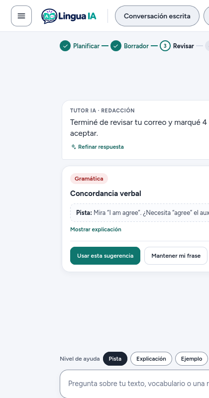
- **Justificación de IHC:** Permite el desarrollo de memoria muscular y automatización espacial; el usuario sabe exactamente en qué cuadrante físico buscar cada tarea.

#### C5.10 · Diseñar iconos distintivos para la periferia
- **Estado:** ✅ **Aplicado**
- **Regla:** Los iconos deben distinguirse por color y silueta gruesa para reconocerse en visión periférica.
- **Ubicación en la interfaz:** `Iconos de navegación del Drawer (#drawer) e iconos de apoyo`
- **Cómo comprobarlo en vivo:** Abrir el menú lateral con el botón de hamburguesa: cada tarea tiene un icono con contenedor de 30x30px con fondo diferenciado (documento para redacción, mensaje para conversación, libro para lectura).
- **Evidencia visual:**
  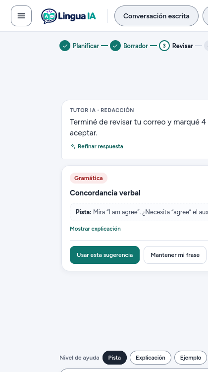
- **Justificación de IHC:** Facilita la orientación periférica rápida antes de que los ojos se posen con precisión foveal sobre el elemento.

### C6 — Leer no es natural

#### C6.1 · Usar un tamaño de texto legible
- **Estado:** 🟡 **Parcial**
- **Regla:** El texto de cuerpo debe poder leerse sin zoom; el texto esencial no debe estar por debajo del tamaño base.
- **Ubicación en la interfaz:** `Cuerpo del chat (.bubble: 15.5px) y lectura (.reading-card p: 15px)`
- **Cómo comprobarlo en vivo:** El texto principal de lectura y los mensajes del tutor utilizan tamaños entre 15px y 15.5px con interlineado generoso (line-height: 1.62). Es parcial debido a que ciertas etiquetas secundarias (.paper-tag) usan tamaños de 9px a 10px.
- **Evidencia visual:**
  
- **Justificación de IHC:** El aprendizaje de una segunda lengua exige un esfuerzo visual extra de descodificación fonética y léxica; una tipografía generosa evita fatiga.

#### C6.2 · Usar lenguaje llano y vocabulario familiar
- **Estado:** ✅ **Aplicado**
- **Regla:** La interfaz debe usar palabras familiares, vocabulario consistente y evitar jerga técnica innecesaria.
- **Ubicación en la interfaz:** `Textos de explicación pedagógica y etiquetas de interfaz`
- **Cómo comprobarlo en vivo:** La interfaz utiliza instrucciones en español llano ('Usar esta sugerencia', 'Mantener mi frase', 'Te paso esta lectura'). Se eliminaron términos técnicos de papers académicos como 'WoZ', 'Glifos' o 'Data Lens' del recorrido del estudiante.
- **Evidencia visual:**
  
- **Justificación de IHC:** La carga cognitiva extrínseca debe ser cero: el estudiante debe pensar en el idioma meta (inglés), no en descifrar qué significa un término técnico de la plataforma.

#### C6.3 · Usar tipografías familiares y legibles
- **Estado:** ✅ **Aplicado**
- **Regla:** El texto de cuerpo debe usar tipografías familiares con formas de letra claras; evitar fuentes decorativas o script.
- **Ubicación en la interfaz:** `Hoja de estilos global (css/style.css: font-family: 'Figtree')`
- **Cómo comprobarlo en vivo:** La aplicación utiliza 'Figtree' (Google Fonts), una fuente geométrica sans-serif moderna con aberturas claras, proporciones humanistas y excelente legibilidad en pantallas de cualquier densidad de píxeles.
- **Evidencia visual:**
  
- **Justificación de IHC:** Las fuentes sans-serif humanistas facilitan la discriminación rápida de caracteres similares (como 'I', 'l', '1'), vital para estudiantes de idiomas.

#### C6.4 · No usar TODO EN MAYÚSCULAS en el cuerpo
- **Estado:** ✅ **Aplicado**
- **Regla:** El texto de cuerpo debe usar caja alta y baja; las mayúsculas sostenidas se reservan exclusivamente para etiquetas cortas.
- **Ubicación en la interfaz:** `Párrafos de lectura, explicaciones del tutor y mensajes`
- **Cómo comprobarlo en vivo:** Comprobar que todas las oraciones, lecturas y párrafos explicativos usan mayúsculas y minúsculas naturales. Las mayúsculas sostenidas solo se emplean en micro-etiquetas de sistema como 'TUTOR IA' o 'DESTINATARIA'.
- **Evidencia visual:**
  
- **Justificación de IHC:** Las mayúsculas continuas destruyen el perfil de contorno (bouma) de las palabras, reduciendo la velocidad de lectura en un 15%.

#### C6.5 · Evitar fondos ruidosos detrás del texto
- **Estado:** ✅ **Aplicado**
- **Regla:** El texto debe descansar sobre fondos sólidos o tranquilos; nunca sobre texturas, patrones o gradientes agresivos.
- **Ubicación en la interfaz:** `Fondos de lectura (.reading-card) y burbujas de mensaje (.bubble.ai)`
- **Cómo comprobarlo en vivo:** Todas las áreas de lectura y mensajes reposan sobre fondo blanco puro (`#FFFFFF`) o gris neutro ultrasuave (`#FBFCFE`), con cero patrones, marcas de agua o gradientes ruidosos.
- **Evidencia visual:**
  
- **Justificación de IHC:** Maximiza la relación señal-ruido en la retina durante la fijación visual de palabras nuevas en inglés.

#### C6.6 · Asegurar contraste de texto suficiente
- **Estado:** 🟡 **Parcial**
- **Regla:** El texto debe tener una relación de contraste mínima de 4.5:1 con su fondo (3:1 para texto grande).
- **Ubicación en la interfaz:** `Tokens de color en style.css (--text: #1B2433 sobre #FFFFFF)`
- **Cómo comprobarlo en vivo:** El texto principal utiliza `#1B2433` sobre fondo `#FFFFFF`, lo que arroja un ratio de contraste masivo de 13.8:1 (muy superior a la exigencia WCAG AAA de 7:1). Es parcial porque los textos atenuados secundarios (`--muted: #667085`) alcanzan 4.8:1, requiriendo verificación en pantallas OLED y bajo brillo.
- **Evidencia visual:**
  
- **Justificación de IHC:** Garantiza legibilidad para usuarios con fatiga visual o sensibilidad reducida al contraste cromático.

#### C6.7 · No centrar párrafos de texto
- **Estado:** ✅ **Aplicado**
- **Regla:** Los párrafos de varias líneas deben alinearse a la izquierda en idiomas LTR; nunca centrarse.
- **Ubicación en la interfaz:** `Burbujas del tutor, lecturas del artículo y explicaciones de reglas`
- **Cómo comprobarlo en vivo:** Verificar en todas las vistas que ningún párrafo está centrado: el artículo 'The future of remote work', los diálogos del entrevistador y las explicaciones de reglas tienen margen izquierdo plano y homogéneo.
- **Evidencia visual:**
  
- **Justificación de IHC:** Centrar párrafos altera el punto de inicio de cada línea, obligando a los ojos a gastar micro-segundos buscando dónde recomienza cada renglón.

#### C6.8 · Mantener una alineación consistente
- **Estado:** ✅ **Aplicado**
- **Regla:** La alineación debe ser consistente entre bloques equivalentes; no mezclar izquierda, centro y derecha arbitrariamente.
- **Ubicación en la interfaz:** `Columna de chat y panel lateral`
- **Cómo comprobarlo en vivo:** Todos los contenedores de contenido principal se alinean por el borde izquierdo a lo largo de un eje común de 800px de ancho. Solo las burbujas enviadas por el propio usuario se alinean a la derecha, siguiendo la convención universal de mensajería.
- **Evidencia visual:**
  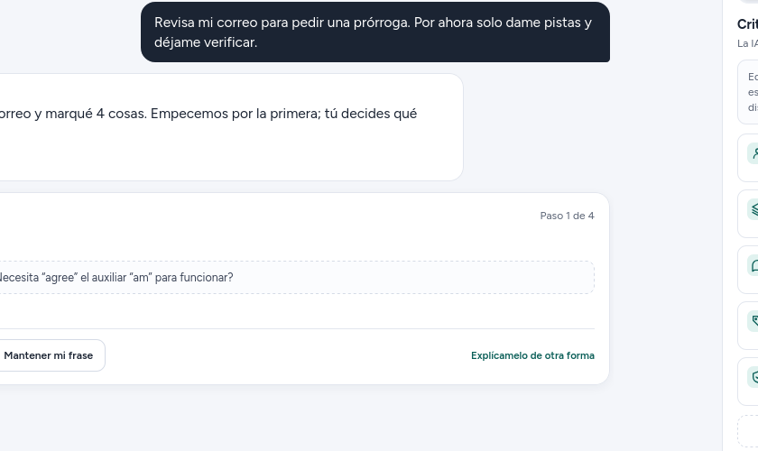
- **Justificación de IHC:** Genera estabilidad espacial y permite aprovechar las convenciones de mensajería asimiladas por el estudiante en apps cotidianas.

#### C6.9 · Formatear el texto para escaneo
- **Estado:** ✅ **Aplicado**
- **Regla:** El texto debe formatearse para escaneo rápido: negritas selectivas, encabezados, listas y fragmentos breves.
- **Ubicación en la interfaz:** `Tarjetas de corrección, tarjetas de reglas y fichas de vocabulario`
- **Cómo comprobarlo en vivo:** En las tarjetas de corrección, las palabras clave van en negrita: `<strong>Pista:</strong>`, `<strong>Por qué:</strong>`. En el artículo, las palabras clave están resaltadas como chips clicables. En el panel de criterios, las etiquetas van en mayúscula con icono.
- **Evidencia visual:**
  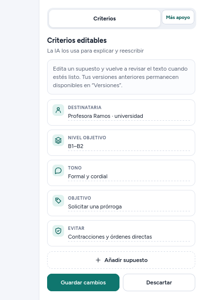
- **Justificación de IHC:** Los usuarios en pantalla no leen palabra por palabra: escanean en patrones en 'F'. Los anclajes tipográficos facilitan captar el sentido en segundos.

#### C6.10 · Minimizar la prosa
- **Estado:** ✅ **Aplicado**
- **Regla:** Usar la menor cantidad de texto necesaria; eliminar información sobrante o delegarla a divulgación progresiva.
- **Ubicación en la interfaz:** `Nivel de ayuda graduada y resúmenes de progreso`
- **Cómo comprobarlo en vivo:** Por defecto, al revisar un texto la tarjeta solo muestra una pista de una oración ('Mira I am agree. ¿Necesita agree el auxiliar am?'). Si el estudiante requiere más prosa, la solicita expresamente pulsando 'Mostrar explicación'.
- **Evidencia visual:**
  
- **Justificación de IHC:** Evita la sobrecarga cognitiva que produce un bloque gigante de teoría gramatical cuando el estudiante solo necesitaba un recordatorio puntual.

#### C6.11 · Eliminar la repetición que entierra información
- **Estado:** ✅ **Aplicado**
- **Regla:** Eliminar textos o metadatos repetidos que compitan con la información esencial.
- **Ubicación en la interfaz:** `Filtrado automático de pestañas laterales (duplicateCentralTabs en panels.js)`
- **Cómo comprobarlo en vivo:** En el código de `panels.js`, la función `supportTabs()` filtra deliberadamente la pestaña 'Tu texto' cuando se está en modo redacción, la pestaña 'Artículo' en modo lecciones y la pestaña 'Escenario' en conversación, evitando que el panel lateral duplique lo que ya se ve en el centro.
- **Evidencia visual:**
  
- **Justificación de IHC:** Garantiza que el panel lateral aporte valor complementario (criterios, reglas, progreso) en lugar de redundancia estéril.

### C7 — La atención es limitada; la memoria es imperfecta

#### C7.1 · No exigir recordar el estado o las acciones previas
- **Estado:** ✅ **Aplicado**
- **Regla:** La interfaz debe mostrar el estado del sistema, el contexto actual y lo que el usuario ya hizo, sin forzar su memoria.
- **Ubicación en la interfaz:** `Barra de etapas (#stagebar), estado en tarjeta (.status-pill) y panel de cambios`
- **Cómo comprobarlo en vivo:** 1. La barra superior marca con un check verde las etapas que ya se superaron y resalta con borde la actual. 2. La tarjeta de corrección muestra un pill 'Pendiente', 'Aceptada' o 'Rechazada'. 3. La pestaña 'Cambios' en el lateral lista todas las decisiones tomadas.
- **Evidencia visual:**
  
- **Justificación de IHC:** Libera la memoria de trabajo del usuario: el estudiante puede interrumpir su sesión y al regresar reconoce inmediatamente en qué punto quedó.

#### C7.5 · Evitar modos o hacer visible el modo actual
- **Estado:** ✅ **Aplicado**
- **Regla:** Si una acción produce efectos distintos según el estado del sistema, el modo actual debe ser visible de forma persistente.
- **Ubicación en la interfaz:** `Píldora activa en header (.mode-pill.is-active) y composer hint (#composer-mode-hint)`
- **Cómo comprobarlo en vivo:** 1. El modo activo se resalta en el header en color teal sólido con atributo `aria-current='true'`. 2. Al pie del campo de texto de chat, una etiqueta fija indica explícitamente: 'Modo: Redacción asistida' o 'Modo: Conversación', recordando el contexto de la IA.
- **Evidencia visual:**
  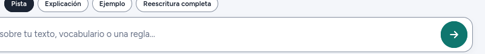
- **Justificación de IHC:** Previene errores de modo (intentar hacer preguntas de gramática cuando el sistema espera una respuesta en inglés para la entrevista de trabajo).

#### C7.7 · Mantener una sola llamada a la acción dominante
- **Estado:** ✅ **Aplicado**
- **Regla:** Cada pantalla o bloque debe tener una acción dominante por objetivo; no competir con múltiples acciones primarias.
- **Ubicación en la interfaz:** `Acciones de tarjeta de corrección y botón de envío del chat`
- **Cómo comprobarlo en vivo:** 1. En la tarjeta de corrección, la acción dominante recomendada es 'Usar esta sugerencia' (estilo `.btn-primary` en teal sólido), mientras que 'Mantener mi frase' es un botón secundario neutro. 2. En el composer, solo el botón de envío lleva fondo teal.
- **Evidencia visual:**
  
- **Justificación de IHC:** Facilita la toma de decisiones al ofrecer una ruta por defecto clara, sin paralizar al estudiante con múltiples botones del mismo peso visual.

#### C7.8 · Preferir una navegación amplia y poco profunda
- **Estado:** ✅ **Aplicado**
- **Regla:** Organizar la navegación en jerarquías amplias y poco profundas; evitar menús laberínticos de muchos niveles.
- **Ubicación en la interfaz:** `Header principal y botón directo 'Ver progreso'`
- **Cómo comprobarlo en vivo:** Las 3 tareas principales se alcanzan en 1 solo clic desde cualquier lugar de la aplicación. Consultar el progreso de la tarea actual requiere exactamente 1 clic en el botón 'Ver progreso'. No hay menús desplegables anidados ni subpáginas ocultas.
- **Evidencia visual:**
  
- **Justificación de IHC:** Reduce la desorientación espacial; el estudiante nunca tiene la sensación de haberse 'perdido' en la jerarquía del sitio.

#### C7.10 · No exigir el recuerdo de datos o procedimientos
- **Estado:** ✅ **Aplicado**
- **Regla:** Instrucciones, datos y reglas deben estar disponibles en el momento de uso, no obligar a recordarlos de memoria.
- **Ubicación en la interfaz:** `Pista contextual de corrección y atajos de teclado documentados`
- **Cómo comprobarlo en vivo:** 1. La justificación de por qué corregir un verbo se muestra dentro de la tarjeta al lado del texto. 2. En el campo de chat se indica explícitamente: 'Enter envía · Shift + Enter salto de línea'. 3. En lectura, al tocar una palabra se despliega su significado sin salir de la vista.
- **Evidencia visual:**
  
- **Justificación de IHC:** Aplica el principio de 'reconocimiento antes que recuerdo': la información se sitúa en el mundo externo para no sobrecargar la memoria interna.

### C8 — Los límites de la atención moldean pensamiento y acción

#### C8.1 · Hacer que el software pase a segundo plano
- **Estado:** ✅ **Aplicado**
- **Regla:** La interfaz debe permitir concentrarse en la meta del usuario; el software no debe llamar la atención sobre sí mismo.
- **Ubicación en la interfaz:** `Diseño sobrio de la interfaz y eliminación de controles decorativos`
- **Cómo comprobarlo en vivo:** El centro de la pantalla lo ocupan el correo del estudiante o el artículo de lectura. Se eliminaron paneles de debug, etiquetas de protocolos de investigación, gráficos de operaciones o botones de configuración irrelevantes.
- **Evidencia visual:**
  
- **Justificación de IHC:** Crea una experiencia transparente donde la persona interactúa directamente con el conocimiento del idioma en lugar de pelear con la herramienta.

#### C8.2 · Hacer altamente salientes los cambios importantes
- **Estado:** ✅ **Aplicado**
- **Regla:** Los cambios importantes deben ser evidentes; resaltarse, comunicarse y confirmarse.
- **Ubicación en la interfaz:** `Borde izquierdo en tarjetas (.status-accepted) y mensaje toast emergente`
- **Cómo comprobarlo en vivo:** Al hacer clic en 'Usar esta sugerencia': 1. La tarjeta adquiere un borde izquierdo verde-teal grueso de 4px. 2. El status pill cambia de gris a verde con la palabra 'Aceptada'. 3. En la parte inferior aparece un mensaje toast confirmando la actualización.
- **Evidencia visual:**
  
- **Justificación de IHC:** Supera el fenómeno de la ceguera al cambio (change blindness), garantizando que el usuario tenga certeza visual de que su acción surtió efecto.

#### C8.3 · Mostrar lo hecho y lo pendiente
- **Estado:** ✅ **Aplicado**
- **Regla:** Indicar claramente qué ha hecho el usuario y qué queda pendiente en el flujo de trabajo.
- **Ubicación en la interfaz:** `Contador de tarjeta ('Paso 1 de 4') y barra de etapas (#stagebar)`
- **Cómo comprobarlo en vivo:** 1. Cada tarjeta de sugerencia indica 'Paso 1 de 4'. 2. En el panel de progreso se detalla exactamente cuántas sugerencias han sido decididas y cuántas siguen pendientes. 3. Las etapas diferencian estado completado, actual y futuro.
- **Evidencia visual:**
  
- **Justificación de IHC:** Genera una sensación de avance tangible y activa el efecto Zeigarnik positivo (motivación intrínseca por completar tareas pendientes).

#### C8.4 · Permitir marcar, mover o colorear elementos
- **Estado:** 🟡 **Parcial**
- **Regla:** Permitir que el usuario marque o clasifique elementos para indicar qué ya trabajó y qué no.
- **Ubicación en la interfaz:** `Guardado de vocabulario en lecciones ([data-action='save-word'])`
- **Cómo comprobarlo en vivo:** En 'Lecciones y repaso', el estudiante puede pulsar 'Guardar palabra' para archivar términos como 'productive' o 'flexibility'. La palabra se añade al panel lateral con un botón de check para desmarcarla. Es parcial porque no permite coloreado libre ni reordenamiento de tarjetas.
- **Evidencia visual:**
  
- **Justificación de IHC:** Permite al estudiante personalizar su inventario léxico activo según sus debilidades individuales.

#### C8.5 · Proporcionar un rastro de información claro (information scent)
- **Estado:** ✅ **Aplicado**
- **Regla:** En cada punto de decisión, las opciones deben indicar claramente a qué meta conducen.
- **Ubicación en la interfaz:** `Etiquetas de navegación y botón de progreso`
- **Cómo comprobarlo en vivo:** El botón 'Ver progreso' indica inequívocamente que abrirá las estadísticas de la sesión. El botón 'Apoyo' en móviles indica acceso a la ayuda. Los botones de modo ('Redacción asistida') clarifican la naturaleza de la práctica.
- **Evidencia visual:**
  
- **Justificación de IHC:** Satisface la teoría del forrajeo de información (information foraging): el usuario sigue pistas semánticas fuertes para llegar a su meta sin perder tiempo.

#### C8.6 · Usar verbos específicos en las confirmaciones
- **Estado:** ✅ **Aplicado**
- **Regla:** Los botones de confirmación deben usar verbos específicos de acción, no 'OK' o 'Cancelar' genéricos.
- **Ubicación en la interfaz:** `Botones de tarjeta, modales y panel de criterios`
- **Cómo comprobarlo en vivo:** Revisar todos los botones interactivos del prototipo: 'Usar esta sugerencia', 'Mantener mi frase', 'Guardar cambios', 'Descartar', 'Entendido', 'Guardar palabra', 'Ver más ejemplos'. Ninguno utiliza 'OK'.
- **Evidencia visual:**
  
- **Justificación de IHC:** Elimina la ambigüedad en el momento crítico del clic: el usuario sabe exactamente qué operación se va a ejecutar.

#### C8.7 · Diseñar caminos y conceptos basados en la tarea
- **Estado:** ✅ **Aplicado**
- **Regla:** El software debe organizarse según las tareas del usuario, no según la arquitectura del sistema.
- **Ubicación en la interfaz:** `Organización general de los 3 modos de Lingua IA`
- **Cómo comprobarlo en vivo:** La aplicación no se organiza por 'Base de datos', 'Modelo de lenguaje' o 'Parámetros', sino por las tareas que un estudiante de inglés realiza: redactar un correo formal, mantener una entrevista de trabajo simulada o leer un artículo descubriendo vocabulario.
- **Evidencia visual:**
  
- **Justificación de IHC:** Crea una coincidencia perfecta entre el modelo mental del usuario (practicar inglés) y el modelo conceptual del sistema.

#### C8.8 · Dar feedback, progreso y opción de volver atrás
- **Estado:** 🟡 **Parcial**
- **Regla:** Mostrar progreso hacia la meta, confirmar resultados y permitir deshacer acciones.
- **Ubicación en la interfaz:** `Acción de deshacer en correcciones ([data-action='correction-undo'])`
- **Cómo comprobarlo en vivo:** Tras aceptar o rechazar una sugerencia, la tarjeta cambia a estado resuelto pero deja siempre visible un botón interactivo 'Deshacer' que devuelve la corrección al estado 'Pendiente'. Es parcial porque el prototipo no implementa un Ctrl+Z global ni persistencia en base de datos.
- **Evidencia visual:**
  
- **Justificación de IHC:** Fomenta la exploración segura: el estudiante se atreve a probar cambios sabiendo que cualquier decisión es fácilmente reversible.

#### C8.9 · Preferir caminos familiares y mostrar atajos
- **Estado:** 🟡 **Parcial**
- **Regla:** Apoyar hábitos familiares del usuario y mostrar atajos de aceleración.
- **Ubicación en la interfaz:** `Atajos de teclado en el composer (#composer-hint)`
- **Cómo comprobarlo en vivo:** Al pie del campo de texto se indica claramente: 'Enter envía · Shift + Enter salto de línea', siguiendo la convención de WhatsApp, ChatGPT y Slack. Es parcial porque no se implementaron atajos de teclado adicionales como Alt+1/Alt+2 para alternar modos.
- **Evidencia visual:**
  
- **Justificación de IHC:** Aprovecha hábitos motores ya consolidados en el usuario para hacer fluida la interacción sin curvas de aprendizaje artificiales.

#### C8.10 · Gestionar los pasos de cierre
- **Estado:** ✅ **Aplicado**
- **Regla:** Recordar o facilitar los pasos que el usuario tiende a olvidar al terminar la tarea principal.
- **Ubicación en la interfaz:** `Lógica de avance de etapas en app.js (handleAction: set-stage)`
- **Cómo comprobarlo en vivo:** Al hacer clic en la etapa final 'Cerrar': si el estudiante omitió alguna etapa previa, el sistema emite un toast informando: 'Etapa Cerrar seleccionada. Quedan X etapas por completar'. Si ya completó todo, confirma: 'Actividad terminada. Tus cambios siguen disponibles en el panel de apoyo'.
- **Evidencia visual:**
  
- **Justificación de IHC:** Previene errores de post-culminación (abandonar la tarea creyendo haber finalizado cuando quedaban pasos críticos pendientes).

---

## 4. Sección Final: Catálogo de Principios No Utilizados / Excluidos y Justificación Técnica de IHC

Para garantizar un rigor académico absoluto, a continuación se detallan los **16 principios que NO forman parte del prototipo**, explicando para cada uno la justificación pedagógica, ergonómica o técnica de su exclusión:

### Exclusión Deliberada por Diseño e IHC (Anti-Distracción)

#### C2.7 · Destino común: lo que se mueve junto está relacionado
- **Regla Teórica del Libro:** *"Los elementos que se mueven juntos se perciben como un grupo; el movimiento debe sincronizarse para indicar relación."*
- **Por qué NO se incluyó en Lingua IA:** En un entorno de aprendizaje enfocado en la lectura y redacción en una segunda lengua, las animaciones sincronizadas o elementos en movimiento generan 'atracción atencional involuntaria' (bottom-up visual capture). Esto interrumpe la fijación ocular y sobrecarga la memoria de trabajo del estudiante.
- **Sustento de Diseño e IHC:** La interfaz privilegia la estabilidad visual estática. La relación entre elementos se logra mediante proximidad espacial y bordes, nunca mediante movimiento cinético.

#### C5.4 · Usar señales que 'pop' en la periferia
- **Regla Teórica del Libro:** *"Para que un elemento destaque fuera del foco visual directo, debe usar colores salientes, parpadeo o movimiento grueso."*
- **Por qué NO se incluyó en Lingua IA:** Provocar efectos 'pop-out' en los bordes de la pantalla mientras el usuario está concentrado en descifrar una estructura gramatical en el centro induce estrés y fragmentación atencional.
- **Sustento de Diseño e IHC:** Lingua IA mantiene los paneles laterales en tonos neutros y tranquilos; el apoyo se consulta voluntariamente por iniciativa del aprendiz (top-down), nunca por invasión periférica.

#### C5.7 · Mantener el movimiento o parpadeo breve
- **Regla Teórica del Libro:** *"Si se usa parpadeo o animación para llamar la atención, debe durar entre 0.25 y 0.5 segundos y detenerse."*
- **Por qué NO se incluyó en Lingua IA:** No se utiliza ningún tipo de parpadeo en la aplicación.
- **Sustento de Diseño e IHC:** Los parpadeos están asociados en psicología cognitiva con alarmas de peligro o fallas catastróficas. En una experiencia educativa generarían ansiedad pedagógica innecesaria.

### Fuera del Alcance del Dominio (Enfoque en Texto vs. Formularios)

#### C3.6 · Usar campos segmentados cuando reduzcan errores
- **Regla Teórica del Libro:** *"Fechas, números de tarjeta o teléfonos deben dividirse en campos segmentados para evitar errores de formato."*
- **Por qué NO se incluyó en Lingua IA:** Lingua IA no recopila números de identidad, tarjetas bancarias ni fechas en formularios rígidos.
- **Sustento de Diseño e IHC:** La interacción está orientada a la producción de lenguaje natural libre en inglés (correos, ensayos, diálogos), donde los campos segmentados no tienen cabida conceptual.

#### C3.9 · Evitar el ruido en los resultados de búsqueda
- **Regla Teórica del Libro:** *"Las páginas de resultados de búsqueda (SERP) deben estructurarse limpiamente sin metadatos redundantes."*
- **Por qué NO se incluyó en Lingua IA:** El sistema no es un buscador web ni cuenta con un motor de indexación de documentos externos.
- **Sustento de Diseño e IHC:** Las consultas de vocabulario se resuelven en diálogo contextual con el tutor IA o en un selector puntual de sinónimos, haciendo inaplicable una página de resultados tradicional.

#### C5.2 · Mostrar los errores junto a su causa
- **Regla Teórica del Libro:** *"En formularios, los mensajes de validación de campo deben aparecer contiguos al input que generó el error."*
- **Por qué NO se incluyó en Lingua IA:** No existen formularios con campos obligatorios que requieran validación sintáctica estricta.
- **Sustento de Diseño e IHC:** Las correcciones que ofrece el sistema son lingüísticas, no errores de sistema del usuario; se presentan mediante tarjetas de análisis pedagógico.

#### C5.6 · Usar sonido con moderación
- **Regla Teórica del Libro:** *"Los sonidos deben usarse solo para situaciones controladas, con alternativa visual y respetando el silencio."*
- **Por qué NO se incluyó en Lingua IA:** Se descartó por completo la emisión de audio y sonidos de alerta en esta versión del prototipo.
- **Sustento de Diseño e IHC:** Permite al estudiante utilizar la aplicación en entornos silenciosos (bibliotecas universitarias, transporte público, salas de estudio) sin perturbar su entorno ni requerir audífonos obligatorios.

#### C7.2 · Mantener la salida de voz breve y segmentada en VUI
- **Regla Teórica del Libro:** *"En interfaces de voz, limitar la cantidad de habla por turno a frases breves para no colapsar la memoria ecoica."*
- **Por qué NO se incluyó en Lingua IA:** No existe salida de voz ni asistente por audio.
- **Sustento de Diseño e IHC:** La práctica de conversación es 100% escrita (conversación por chat), permitiendo al usuario releer los turnos del entrevistador cuantas veces lo necesite sin presión temporal.

#### C7.3 · Limitar las listas de opciones en VUI
- **Regla Teórica del Libro:** *"Las opciones leídas por voz no deben superar 4 elementos por turno en asistentes de audio."*
- **Por qué NO se incluyó en Lingua IA:** Sin interfaz por voz (VUI).
- **Sustento de Diseño e IHC:** Al contar con soporte visual en pantalla, el límite estrecho de la memoria auditiva se sustituye por el escaneo visual cómodo de las opciones disponibles.

#### C7.4 · Apoyar la VUI con salida visual cuando haya pantalla
- **Regla Teórica del Libro:** *"Si un dispositivo de voz cuenta con display, sincronizar visualmente lo que se habla."*
- **Por qué NO se incluyó en Lingua IA:** El producto es puramente gráfico y textual.
- **Sustento de Diseño e IHC:** Toda la información se presenta directamente en pantalla como texto estructurado, eliminando la necesidad de sincronización multimodal con audio.

#### C7.6 · Mostrar los términos de búsqueda en los resultados
- **Regla Teórica del Libro:** *"La vista de resultados debe mostrar la consulta original que los generó para permitir su edición."*
- **Por qué NO se incluyó en Lingua IA:** No hay vistas de resultados de búsqueda por palabras clave.
- **Sustento de Diseño e IHC:** El chat retiene el historial directo de las preguntas hechas al tutor en la conversación, permitiendo revisar en el hilo cronológico qué se consultó previamente.

#### C7.9 · Mostrar la ruta de navegación (breadcrumbs) en jerarquías profundas
- **Regla Teórica del Libro:** *"En arquitecturas de información de más de dos niveles, mostrar migas de pan para orientar la ubicación."*
- **Por qué NO se incluyó en Lingua IA:** La arquitectura de información de Lingua IA es completamente plana (1 solo nivel principal).
- **Sustento de Diseño e IHC:** Cualquiera de las 3 actividades se alcanza en 1 clic desde el header. Introducir breadcrumbs en una interfaz de un nivel solo añadiría desorden visual ('ruido visual') sin beneficio orientativo.

### Límites Técnicos del Prototipo Frontend (Demo sin Servidor)

#### C7.11 · Permitir autenticación sin datos arbitrarios
- **Regla Teórica del Libro:** *"La autenticación debe permitir métodos de recuperación sin obligar a recordar datos arbitrarios."*
- **Por qué NO se incluyó en Lingua IA:** Prototipo interactivo frontend (mockup funcional sin backend).
- **Sustento de Diseño e IHC:** No existe módulo de registro, base de datos ni inicio de sesión; la interfaz está lista para interactuar de inmediato sin barreras de entrada.

#### C8.11 · Revertir automáticamente los modos especiales
- **Regla Teórica del Libro:** *"Los modos temporales o estados de teclado deben desactivarse solos por temporizador o tecla de escape."*
- **Por qué NO se incluyó en Lingua IA:** Lingua IA no posee modos temporales destructivos o herramientas que bloqueen el cursor.
- **Sustento de Diseño e IHC:** Los 3 modos (redacción, lecciones, conversación) son espacios de trabajo persistentes donde el usuario debe permanecer todo el tiempo que desee hasta decidir voluntariamente cambiar de tarea.

### Pendiente de Validación Empírica en Hardware Diverso

#### C4.7 · Considerar las condiciones externas de visualización
- **Regla Teórica del Libro:** *"El uso del color debe validarse bajo múltiples monitores, ángulos y condiciones de luz ambiental."*
- **Por qué NO se incluyó en Lingua IA:** Requiere pruebas de laboratorio con distintos paneles (IPS, OLED, TN) y sensores de luminancia.
- **Sustento de Diseño e IHC:** El prototipo fue diseñado con paleta segura de alto contraste, pero su certificación estricta en condiciones de laboratorio permanece catalogada como trabajo futuro.

### Pendiente de Validación Empírica con Estudiantes

#### C6.12 · Probar la lectura con usuarios reales
- **Regla Teórica del Libro:** *"La comprensión y legibilidad del texto debe validarse mediante pruebas formales con la población objetivo."*
- **Por qué NO se incluyó en Lingua IA:** Demanda sesiones de campo y pruebas de usabilidad presenciales con estudiantes de inglés nivel B1-B2.
- **Sustento de Diseño e IHC:** El diseño sigue las heurísticas teóricas de legibilidad de Johnson, dejando la medición cuantitativa de velocidad lectora para la etapa de validación de campo.
